Dashboards
==========

The dashboards are sophisticated, interactive visualizations from time
series data. It features a browser-based interface that
enables users to build complex analytical dashboards without
programming knowledge, while still supporting advanced configuration
options for power users.

.. note::

   This is an essential feature of the Timeseries Refinery. It is only accessible within the pro version.
   If interested, please visit: https://timeseries.pythonian.fr/#ouroffer. 

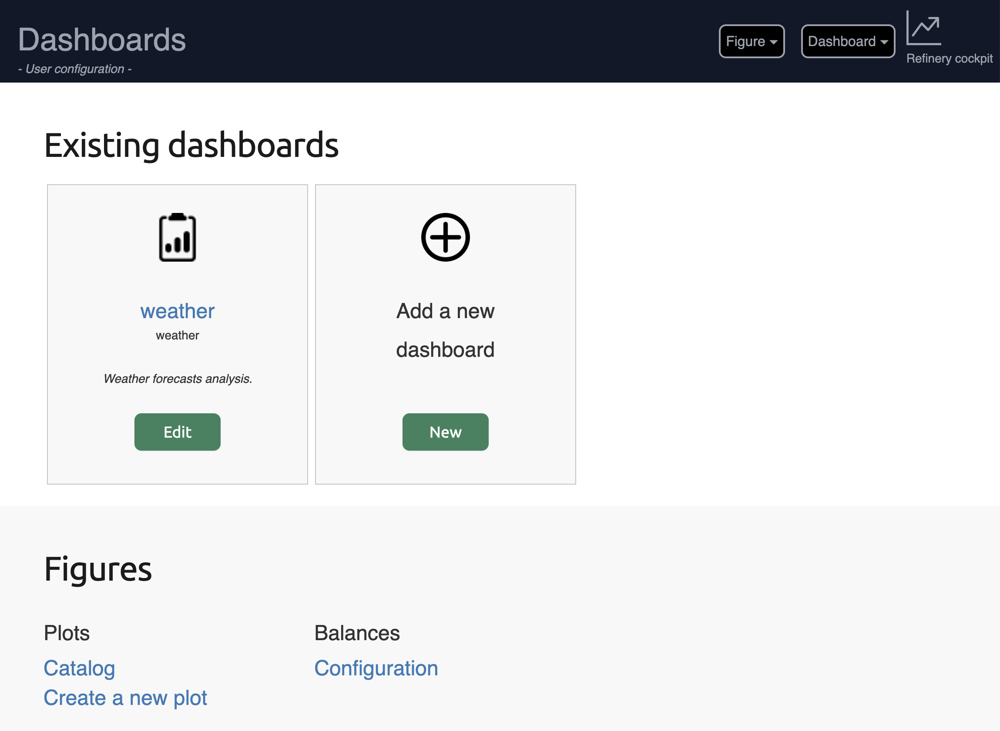

Dashboard Editor
----------------

The dashboard editor provides a comprehensive visual interface for
creating or modifying real-time dashboards.

Creating a New Dashboard
~~~~~~~~~~~~~~~~~~~~~~~~

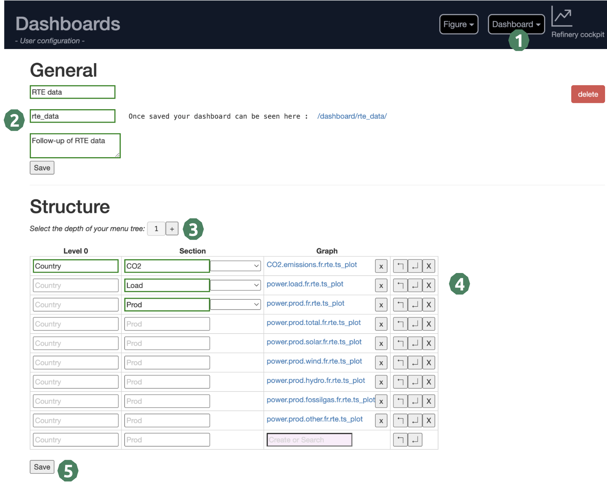

1. **Access the Dashboard Editor**: From the dashboard's homepage, or the "dashboard" dropdown at the top right of the page.
2. **General information**: Define the title, the segment (of the future link of your dashboard) and a short description.
3. **Menu depth**: Set up the depth of your menu tree. You'll be able to increase it later if you reorganize your page.
4. **Structure**: Define level and section names. Organize your figures in the right sections. A figure catalog is available to choose existing figures.
5. **Save**: Save your dashboard and follow the link given in the "General" section to view it. You can share this link with your team!

.. warning::

    Mandatory fields are highlighted with red dots appearing in the input field. You cannot save your dashboard if mandatory fields are empty.

Dashboard layout
----------------

A dashboard is organised according to a menu located on the left side of the screen. 
Each page of the menu is divided into sections in order to organise figure presentation. 
Forms can be associated to a section in order to allow the user to choose custom time periods.

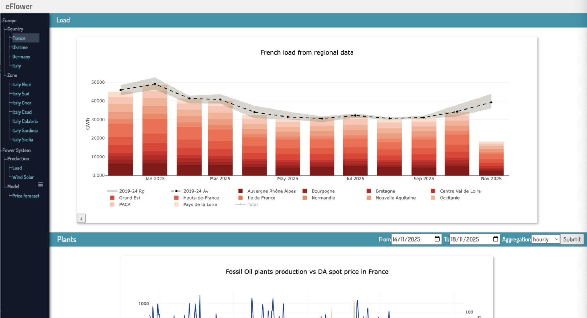

**Menu**

    The menu is represented in the black area on the left side of the dashboard (see above).
    The menu has a tree structure, with a variable depth (chosen by the user, here we have a depth 3).

**Sections**

    The figures are presented in named sections (see the blue banners). In this example, we have two sections: "Load" and "Plants".

**Forms**

    A section can be associated with a date form (example here in the "Plants" section). If selected, the user can request to see another period than the one presented by default in the figure.

A figure can be presented in various dashboards. 

Figure Editor
-------------

The figure editor provides a powerful interface for creating complex
visualizations.

Creating a New Figure
~~~~~~~~~~~~~~~~~~~~~

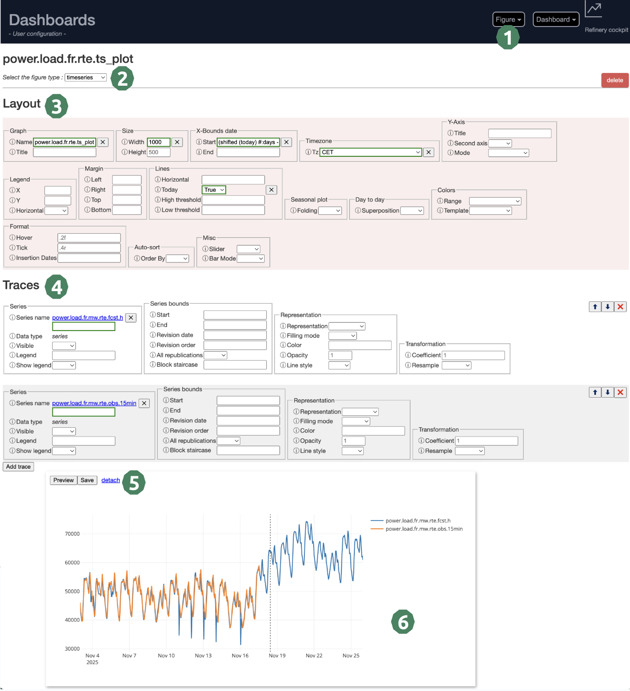

1. **Access the Figure Editor**: From the dashboard's homepage, or the "Figure" dropdown at the top right of the page.
2. **Select the figure type**: Choose between timeseries, table, group... All types of graphs are presented further down this page.
3. **Layout information**: Define the graph_id (mandatory) and all layout parameters that you need. If you need information on a parameter, click on the "i" to the left of it.
4. **Trace information**: Every line of your plot is linked to a trace. Define here the number of traces and its parameters. At least one trace is mandatory.
5. **Save or Preview ?**: If you select "Preview", the plot will load without saving it. It is useful when you test parameters. (It is also quicker than "Save")
6. **Visual validation**: Analyse the resulting plot in this area. If you are happy with it, don't forget to save it if you haven't already done so. 

.. warning::

    Mandatory fields are highlighted with red dots appearing in the input field. You cannot save your figure if mandatory fields are empty.

Figure editor features
~~~~~~~~~~~~~~~~~~~~~~

**Multi-trace Management:**
    - Add unlimited data traces to single graphs
    - Individual parameter configuration per trace
    - Visual reordering with drag-and-drop functionality

**Dynamic Parameter Forms:**
    - Automatically generated forms based on graph type
    - Conditional fields that appear/disappear based on selections
    - Search and select from available time series catalogs
    - Real-time validation with user feedback
    - Interactive help system with examples and documentation

**Date and Time Handling:**
    - Smart date parsing and validation
    - Support for complex date expressions
    - Relative date specifications (last month, yearstart, lastoccurrenceof, etc.)

**Preview System:**
    - Live preview with real-time graph generation
    - Floating/dockable preview windows for improved workflow
    - Error handling with clear diagnostic messages

Figure Types
------------

Timeseries
~~~~~~~~~~
This is the most common figure type, ideal for displaying time-oriented data with a horizontal date axis.
It is particularly useful for monitoring trends, detecting patterns, and comparing multiple series over time.

**Common use cases:**
    - Energy production and consumption monitoring
    - Price evolution tracking
    - Temperature and weather data visualization
    - Financial metrics and KPIs evolution

**Available options:**
    - Line plots with multiple styling options
    - Area charts with configurable fill modes
    - Stacked and grouped bar configurations
    - Seasonal overlays for year-over-year analysis
    - Multi-axis support for different data scales

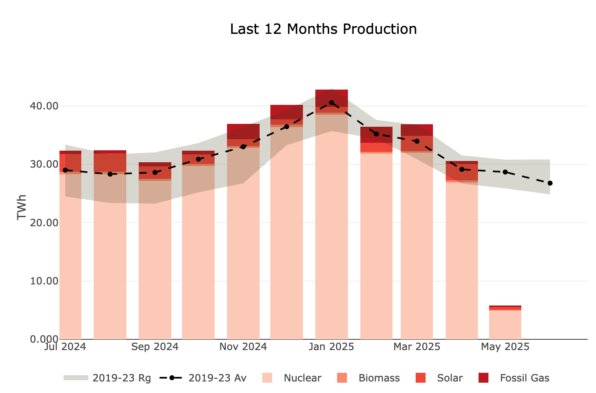

Table
~~~~~
The table figure displays time series data in a tabular format, making it easy to read precise values
and compare data across different time periods. This format is particularly useful for reports,
data exports, and when exact numerical values are more important than visual trends.

**Common use cases:**
    - Detailed numerical reports with exact values
    - Comparison of multiple series side by side
    - Monthly or yearly aggregated summaries

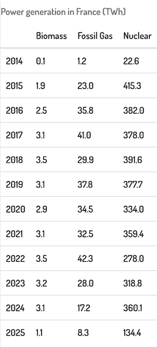

Scatter
~~~~~~~
The scatter plot is essential for analyzing correlations and relationships between two variables.
When hovering over the correlation line, statistical information appears including the correlation coefficient.

**Common use cases:**
    - Correlation analysis between two time series
    - Identifying linear or non-linear relationships
    - Detecting outliers and anomalies
    - Validating model predictions against observations

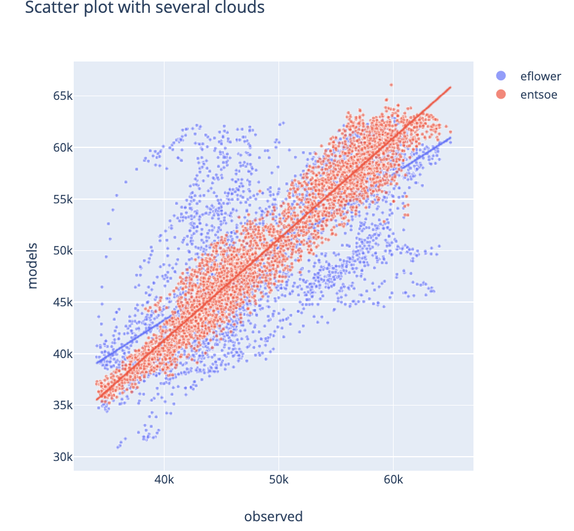

Daily Profile
~~~~~~~~~~~~~
The daily profile plot is specialized for intraday data, presenting the daily pattern hour by hour
across multiple days. This visualization highlights recurring patterns and helps identify typical
daily cycles.

**Common use cases:**
    - Electricity load profiles (daily consumption patterns)
    - Intraday trading activity analysis
    - Temperature variations throughout the day
    - Traffic or usage patterns during business hours

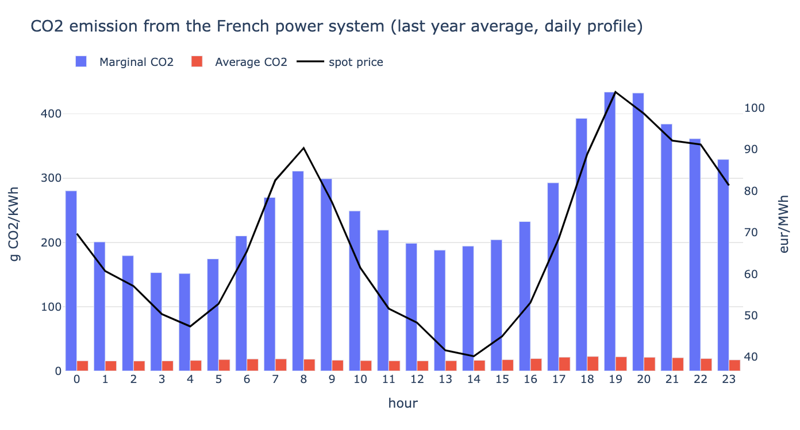

Candlestick
~~~~~~~~~~~
The candlestick figure is a standard visualization for market data, displaying Open, Close, High,
and Low values for each time period. Each candlestick provides a comprehensive view of price
movement within a single time interval.

**Common use cases:**
    - Stock price visualization
    - Commodity market analysis
    - Energy market price movements

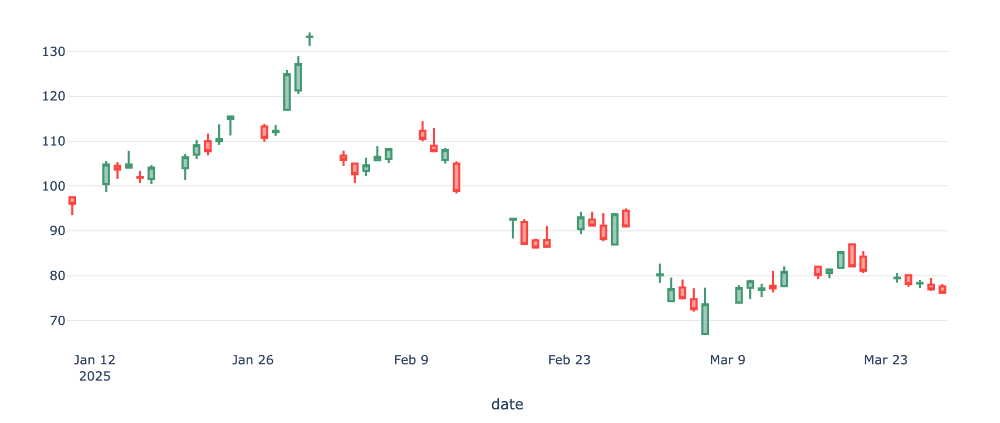

Balance
~~~~~~~
The balance figure presents hierarchical data in a table format where values are organized by
aggregation levels. Each lower level can be summed up to obtain the corresponding upper level,
ensuring data consistency and making it easy to drill down from aggregated to detailed values.

**Common use cases:**
    - Financial statements (revenue breakdown by category)
    - Energy balance sheets (production by source)
    - Hierarchical budget tracking
    - Multi-level data aggregation and reconciliation

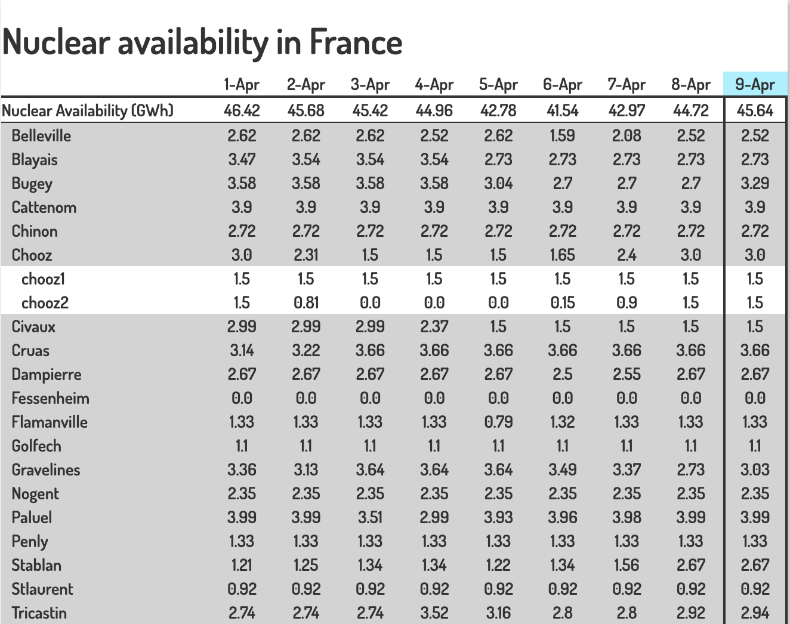

Balancedelta
~~~~~~~~~~~~
The balance delta figure highlights the differences between two versions of a balance table,
making it easy to identify what changed between two time periods or data revisions. This is
particularly useful for tracking changes and understanding data evolution.

**Common use cases:**
    - Month-over-month or year-over-year comparison
    - Budget vs actual variance analysis
    - Revision tracking (forecast updates)
    - Change detection in hierarchical data

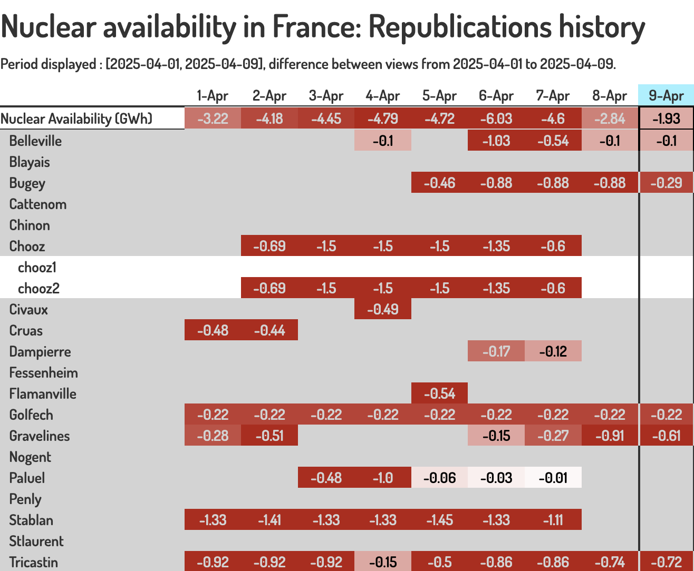

Group
~~~~~
The group figure is designed to visualize "group" data, which represents multiple related scenarios
or ensemble forecasts. It displays all members of a group simultaneously, allowing comparison
between different scenarios or model runs.

**Common use cases:**
    - Weather ensemble forecasts (multiple model runs)
    - Monte Carlo simulation results
    - Scenario planning (best case, worst case, expected)
    - Uncertainty quantification in predictions

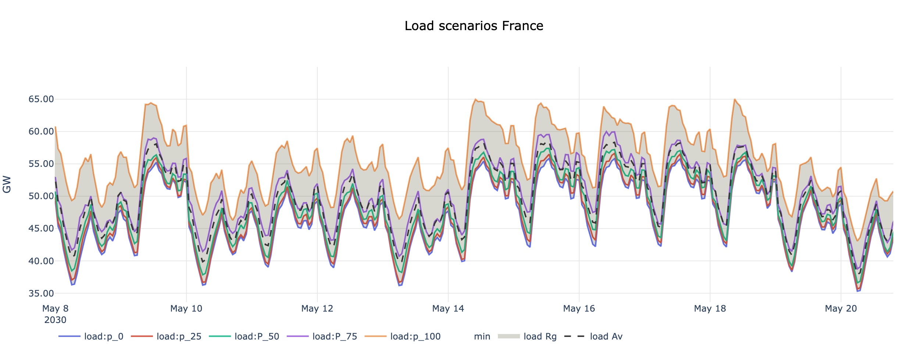

.. note::

    Keep in mind that new figure types can be easily added.

Figures catalog
---------------

The search interface provides comprehensive figure discovery
capabilities:

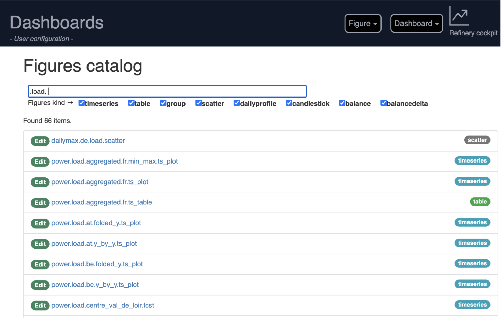

**Multi-criteria search:**
    - Intelligent keyword-based filtering across figure names
    - Figure type filtering (timeseries, tables, custom types, ...)

**Figure information:**
    - Type-based categorization with visual badges
    - Direct editing access with one-click navigation
    - Embedded preview functionality

Legacy CSV Configuration Support
---------------------------------

While the web interface is the primary creation method, Tshistory
Dashboard maintains support for CSV-based configuration for:

    - Importing existing dashboard configurations
    - Bulk creation of similar visualizations
    - Automated dashboard generation via scripts

.. note::

   A Python client will be available in a next version of the tool.
   This client will allow users to create, modify or delete figures and dashboards programmatically.
   It will ease the *automated dashboard generation*.

Access
------

The dashboards are accessible from the menu. 
By default, there are fully integrated to the app (under the segment `/dashboards`).

If needed, it can run as a standalone app. 
It might be useful to have separated domains if user access are different between refinery and dashboard.
In this case, a "dashboard" section is expected in the tshistory.cfg file: 

.. code:: ini

   [dashboard]
   refinery = https://refinery.example.com/
   dashboards = https://dashboard.example.com/
