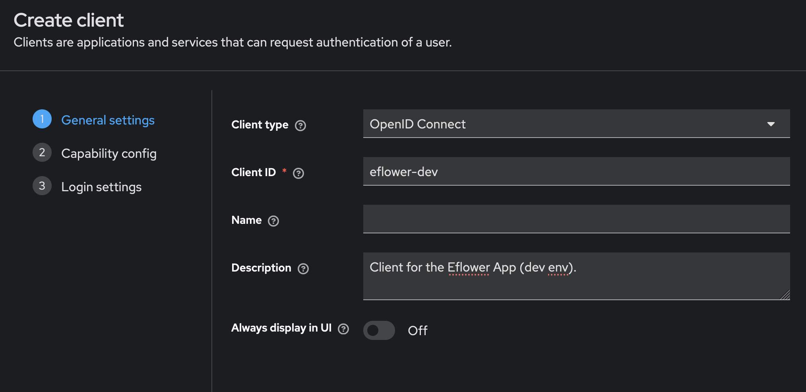
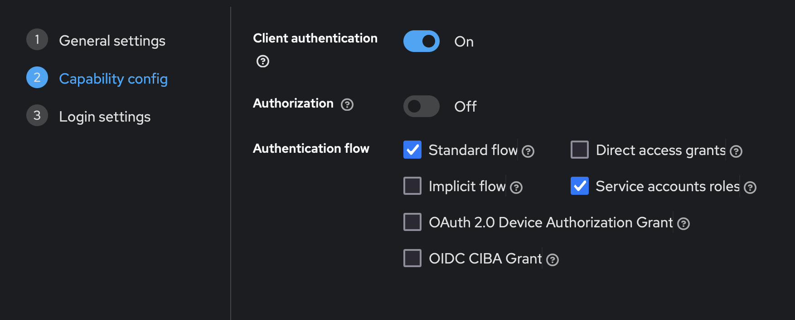
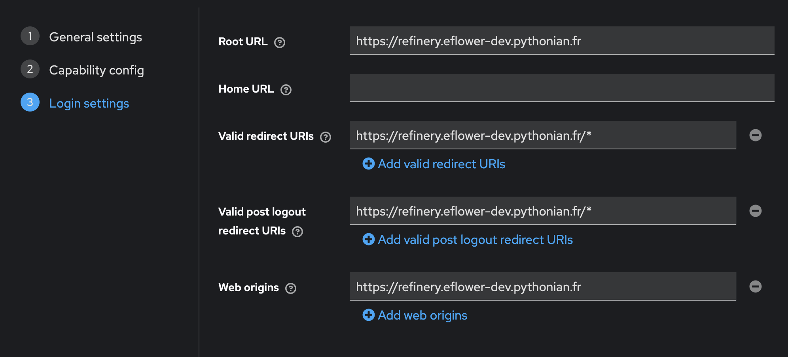
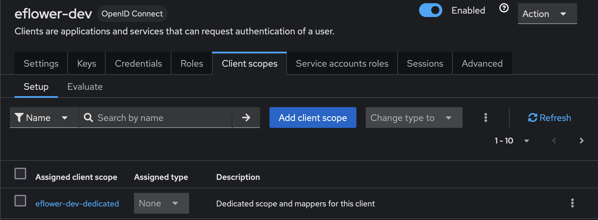
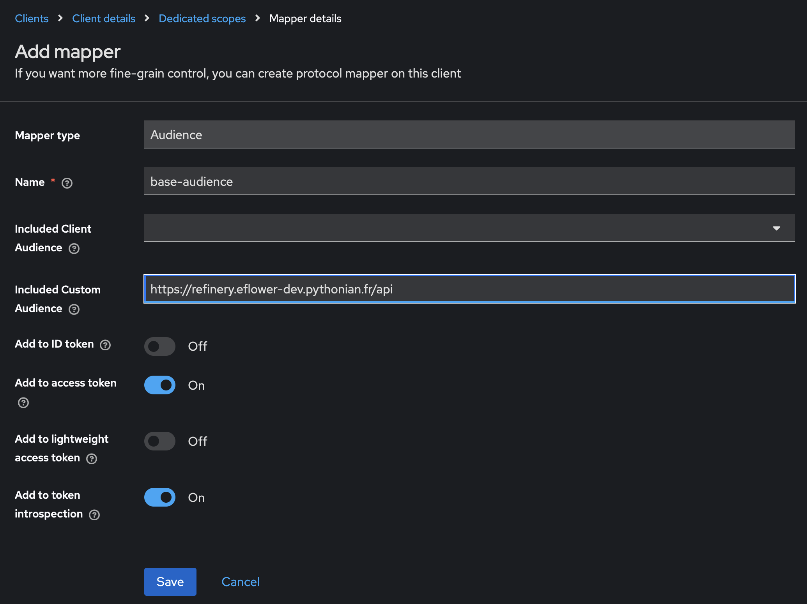
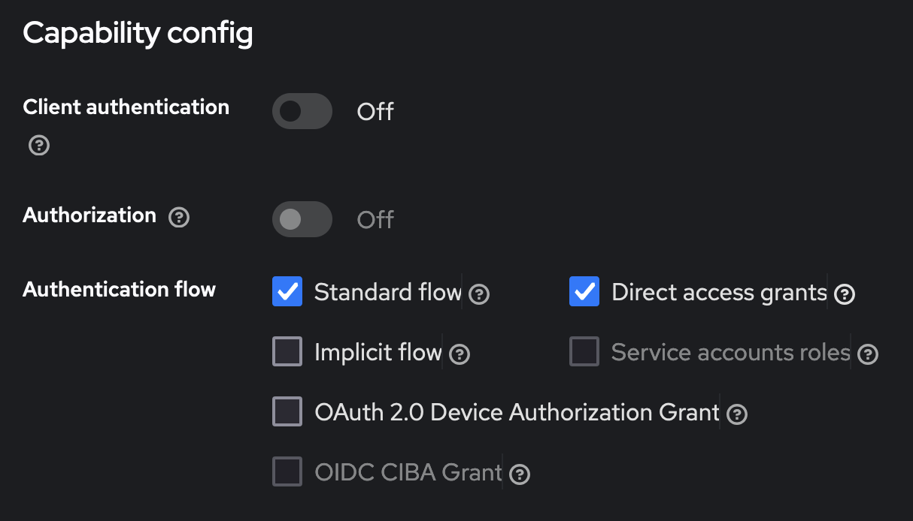

Securing the Refinery
=====================

Two modalities are available:

* Http `basic-auth <https://developer.mozilla.org/en-US/docs/Web/HTTP/Authentication>`_

* `OpenID Connect <https://en.wikipedia.org/wiki/OpenID#OpenID_Connect_(OIDC)>`_

Setting up  basic auth
----------------------

Most of the setup happens with your web frontend, for instance `Nginx
<https://nginx.org/en/>`_. You should consult the relevant
documentation to set up the basic auth mechanism. This will provide a
simple login + password form in front of the application.

Now, if you want to make a data-mesh configuration work in this
context, you have to provide the credentials of the target instance in
the `tshistory.cfg` configuration file.

Let's start with a sample configuration with one external source:

.. code:: ini

 [dburi]
 power = postgresql://power

 [sources]
 power.meteo = https://refinery.meteo.acme.com/api

This describes a `power` refinery that also consumes meteorogical data
from a `meteo` instance. Now if you just put http basic auth in front
of your `meteo` instance, you have to add a new section like the
following:

.. code:: ini

  [auth]
  meteo.uri = https://refinery.meteo.acme.com/api
  meteo.login = <login>
  meteo.password = <password>

Working with OpenID Connect
...........................

This enables a very secure and seamless SSO experience for users if
well configured. Moreover, it permits to assign roles to the
users. Let's describe them right away, and their associated
capabilities:

* `guest` : user is vetted by the OIDC platform but is unknown from
  the Refinery. Can't do nor see anything.

* `ro` : with this role, everything can be read, nothing can be
  created, updated or deleted.

* `rw` : this role allows all `CRUD
  <https://en.wikipedia.org/wiki/Create,_read,_update_and_delete>`_
  operations except specific things only Admins can do.

* `admin` : this role can do everything.

Now, back to the setup. In the next chapter, we will see how to
configure one particular OIDC platform (`KeyCloack
<https://www.keycloak.org/>`_) for a Refinery instance. And in the
subsequent chapter, we will configure the Refinery instance for all
the relevant access scenarios.

Indeed, we need these 3 scenarios to be handled:

* web access by end users

* robot access (or `machine to machine`) by e.g. scrapers, models,
  etc.

* scripting access for end users

Though the last two ones look similar, their security context is
differents:

* the robots are hosted on a secure server platform,

* the end user runs from an a priori unsecure computer.

Setting up KeyCloak clients
---------------------------

KeyCloak is a powerful and also complex platform and we don't cover
its use at all. We are only concerned with the configuration of what
is commonly used an OIDC `client`. To properly secure all access modes
to a Refinery, we need two such clients and we will show how to
configure them. Such configuration steps should be similar with other
OIDC platforms.

Confidential client
...................

The first client is said to be `confidential (or private)
<https://oauth.net/2/client-types/>`_ because its users (except for
the web browser) are deemed secure enough to host the necessary
credentials (especially the `client_secret`). It covers the need of:

* web access,

* robot access.

Let's configure one for our `eFlower` application (which is about
power prices and marginal co2 forecasts).

In KeyCloak, we create the client as such:

The `client_id` is the most important piece of information there. Note
it for later.

Then, the second part:

The `client authentication flow` flag is of utmost importance, since
it indicates this is a confidential or `confidential` client.

Now we have to setup a number of uris:

These of course must match the specific uris you have for the
`eFlower` application.

As a last step, we are going to configure an `audience` for our
application. First, go to the `Client Scopes` tab.

There, you will see a list of `scopes` including one that has been
created automatically for you (at client creation time) named
`eflower-dev-dedicated`. Click on this item. You land in a section to
manage `mappers` and `scope` for `eflower-dev-dedicated`. Chose `Add a
mapper` (by configuration), and fill this:

Public client
.............

Create a new client with the `eflower-dev-public` id. The important
differences with the confidential client lie in:

* an additional `Valid redirect URI`: http://localhost:5000/*

* the client authentication field must be set to `off`

The audience, like other parameters, must be set up the same way as
with the confidential client.

Setting up the Refinery configuration files
-------------------------------------------

The `tshistory.cfg` must be augmented in the `[auth]` sections.

For a machine to machine configuration (typically server side), you
want something like this (with the `secret` set to an appropriate
value):

.. code:: ini

   [auth]
   eflower_dev.uri = https://refinery.eflower-dev.pythonian.fr/api
   eflower_dev.client_id = eflower-dev
   eflower_dev.client_secret = <secret>
   eflower_dev.domain = id.cloudcrane.tech.scaleway.cloudcrane.io/realms/pythonian

For Python users on their laptops, using a Python shell or Notebook,
the `pkce` option is needed. In this case, the personal computer is
considered too insecure to host the `client_secret` and we also want
to identify exactly who is making the calls.

So we don't have a `client_secret` entry but a `pkce` key with no
value. Also we must refer to the right client (the `public` one). Here
is how it goes:

.. code:: ini

   [auth]
   eflower_dev.uri = https://refinery.eflower-dev.pythonian.fr/api
   eflower_dev.pkce =
   eflower_dev.client_id = eflower-dev-public
   eflower_dev.domain = id.cloudcrane.tech.scaleway.cloudcrane.io/realms/pythonian
