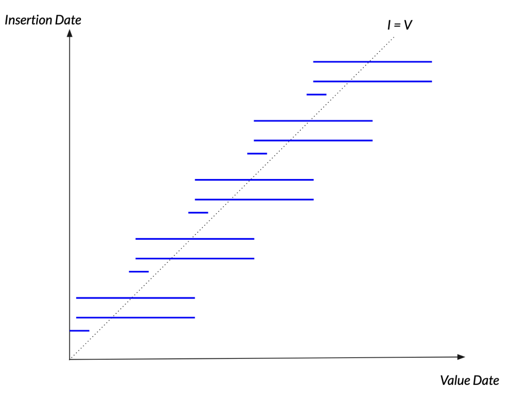
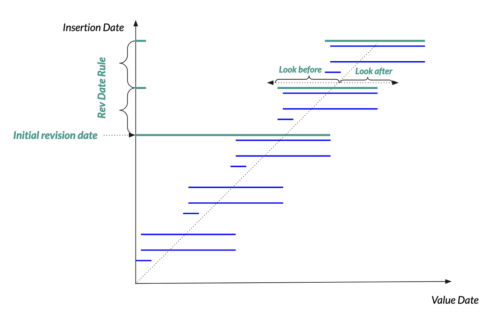
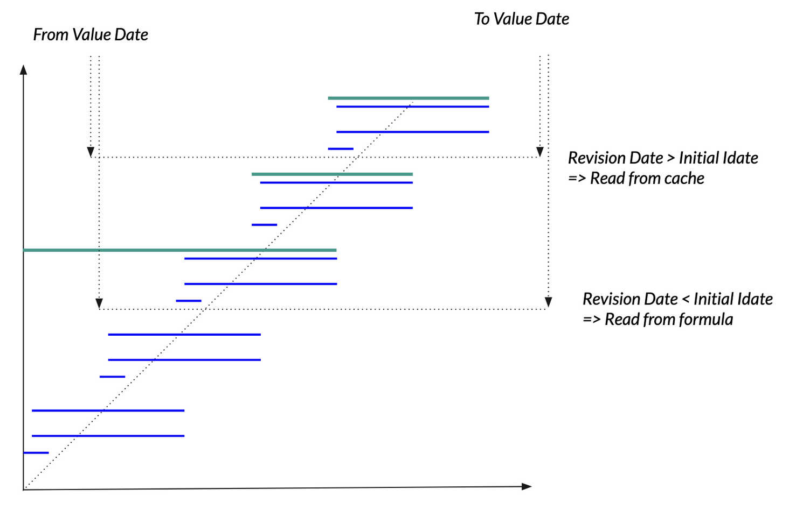

To the next level
=================

In this chapter we will explore aspects of the system that go beyond
the simplest steps taken to build a relatively simple time series
information system.

We will address:

* performance issues regarding stored and computed series

* working in depth with the task manager to build robust pipelines

* how to efficiently organize the acquisition of a vast referential of
  raw series

Doing your own app using the Refinery
-------------------------------------

The Refinery works well as a stand-alone tool, until you need to do
any of the following:

* data acquisition with dedicated tasks

* new api points

* new formula operators

The first item is by far the most common.

We propose to start with a skeleton app that we will call "myapp". It
structure is as follows (standard Python package app):

.. code:: bash

   myapp
   ├── myapp
   │   └── __init__.py
   └── setup.py

The `setup.py` should be minimal and may contain this:

.. code:: python

   from setuptools import setup

   setup(name='myapp',
      version='0.1.0',
      author='MyCorp',
      author_email='myself@mycorp.fr',
      description='Provide scrapers and tasks for my refinery',
      packages=['myapp'],
      install_requires=[
          'tshistory_refinery'
      ],
   )

Data acquisition: a structured path
------------------------------------

In the chapter :ref:`Pipelines : starting with injecting data` we
described an effective yet rudimentary strategy to implement data
acquisition. The Refinery provides a tool to enable a better
organization of this.

We will organize the scraping into two modules:

* `scrap_collection.py`

* `scrap_config.py`

The project application structure should be like this:

.. code:: bash

   myapp/
   ├── myapp
   │   ├── __init__.py
   │   ├── scrap_collection.py
   │   └── scrap_config.py
   └── setup.py

The first one, `scrap_collection`, will host all our scraping
functions. The second one, `scrap_config`, will provide a global
scraping configuration for the application and of course use the
scraping functions defined in the first one.

Let's examine `scrap_collection.py`, restarting from the minimalistic
scraper we wrote for the :ref:`Pipelines : starting with injecting
data`.

.. code:: python

   import pandas as pd
   from entsoe import EntsoePandasClient

   def get_res_generation_forecast_entsoe(zone, fromdate, todate):
       metadata = {
           'source': 'entsoe',
           'country': zone,
           'category': 'res generation',
           'series-type': 'forecast'
       }
       try:
          df = EntsoePandasClient(api_key='apikey').query_wind_and_solar_forecast(
              zone,
              start=fromdate.tz_localize('Europe/Paris'),
              end=todate.tz_localize('Europe/Paris'),
          )
       except NoMatchingDataError:
          return pd.DataFrame(), metadata

       return df, metadata

Here are the differences with the previous one:

* there is a `zone` parameter rather than a hard-coded 'FR' zone

* we have a pair of `fromdate` and `todate` parameters

* we don't insert any data, we just return what we got (a time series
  and a dict to hold the metadata)

Let's try to do something out of this immediately, this time we will
populate the `scrap_config` module:

.. code:: python

   from functools import partial

   from tshistory_refinery.scrap import (
       Scrap,
       Scrapers
   )

   from myapp.scrap_collection import get_res_generation_forecast_entsoe

   SCRAPERS = Scrapers(
       Scrap(
          names={
              'power.prod.solar.fr.mwh.entsoe.fcst.h': 'Solar',
              'power.prod.windonshore.fr.mwh.entsoe.fcst.h': 'Wind Onshore'
          },
          func=partial(get_res_generation_forecast_entsoe, 'FR'),
          schedrule='0 5 * * * *',
          fromdate='(shifted (today) #:days -1)',
          todate='(shifted (today) #:days 7)',
          initialdate='(date "2015-1-1")'
       ),
       Scrap(
          names={
              'power.prod.solar.be.mwh.entsoe.fcst.h': 'Solar',
              'power.prod.windoffshore.be.mwh.entsoe.fcst.h': 'Wind Offshore',
              'power.prod.windonshore.be.mwh.entsoe.fcst.h': 'Wind Onshore'
          },
          func=partial(get_res_generation_forecast_entsoe, 'BE'),
          schedrule='0 5 * * * *',
          fromdate='(shifted (today) #:days -1)',
          todate='(shifted (today) #:days 7)',
          initialdate='(date "2015-1-1")'
       )
   )

Let's analyze this step by step, as there is a lot to unpack. As you
can see at first glance, we can re-use our scraping functions for
several uses and generate not just a pair of time series.

At the top-level, we define this big global variable named SCRAPERS,
which will indeed contain the scrapers hold by the `Scrapers` object.

The `Scrapers` object will collect as many individual scrap
configurations as needed (as coma separated objects). These are to be
defined with the `Scrap` object.

Let's look at the first one.

.. code:: python

          names={
              'power.prod.solar.fr.mwh.entsoe.fcst.h': 'Solar',
              'power.prod.windonshore.fr.mwh.entsoe.fcst.h': 'Wind Onshore'
          }

The names in this case is a mapping from the final series name we want
to the series names the scraping function will acquire (which is
determined by the data provider, obtained through documentation ... or
looking at what comes at the end of their api). A scraping function
can get one or many series.

.. code:: python

          func=partial(get_res_generation_forecast_entsoe, 'FR'),

This `func` parameter takes the scraping function. The signature of a
scraping function *must* be of the form:

.. code:: python

   funcname(fromdate: pd.Timestamp, todate: pd.Timestamp)

That is: accept two positional parameters, `fromdate` and `todate`
that must be a standard Python datetime or a Pandas timestamp (which
must be timezone aware).

Our concrete scrap function in fact wants a first `zone` parameter,
which is why, to be compliant, we give `func` a partial application of
the scrap function with a concrete value ('FR'). Hence we can re-use
this technique for as many zones as upstream knows, and in our example
with 'BE'.

Next: the scheduling rule.

.. code:: python

   schedrule='0 5 * * * *',

This declares a `cron rule <https://en.wikipedia.org/wiki/Cron>`_ with
support for seconds. In this case we want it to run every hour of
every day at minute 5 and second 0.

Then come the parameters for the horizon/time windows.

.. code:: python

          fromdate='(shifted (today) #:days -1)',
          todate='(shifted (today) #:days 7)',
          initialdate='(date "2015-1-1")'

`initialdate` specifies the first time stamp wanted for the series,
`fromdate` and `todate` specify the time window for a given time
series update.

.. note::

   `initialdate` will be used once, when the series we want does not
   yet exist. The initial series history will be built from there.

The three timestamps are defined using a mini expression language
comparable to that of the formula language. The tree primitives are:

* `today` -> returns a timestamp as of today

* `date <datestr>` -> builds a timestamp from a string

* `shifted <date> <delta>` -> shifts a date by a given delta

.. note::

   The <delta> for `shifted` is using a keyword notation. The
   available keywords are `#:hours`, `#:days`, `#:weeks`, `#:months`

In our case, since we are fetching a 7 days forecast, it is entirely
reasonable to fetch data from yesterday to the next 7 days.

Well, having explained all of that, are we done yet ? Almost !

The last step will be about the final setup: we need the task system
to be made aware of what we have done, and we will do it through a
command line operation of the `myapp` application.

This entails having a `cli` (for "command line interface") module in
`myapp`, whose tree now looks like that:

.. code:: bash

   myapp/
   ├── myapp
   │   ├── cli.py
   │   ├── __init__.py
   │   ├── scrap_collection.py
   │   └── scrap_config.py
   └── setup.py

Let's write the `cli.py` module contents:

.. code:: python

   import click

   from tshistory.api import timeseries
   from tshistory_refinery import cache

   from myapp.scrap_config import SCRAPERS

   @click.group()
   def myapp():
       pass

   @myapp.command(name='setup-scrapers')
   def setup_scrapers():
       tsa = timeseries()
       engine = tsa.engine

       with cache.suspended_policies(engine):
           for scraper in SCRAPERS.scrapers.values():
               scraper.prepare_task(engine)

   @myapp.command(name='first-imports')
   def first_imports():
       tsa = timeseries()
       engine = tsa.engine
       for scr in SCRAPERS.scrapers.values():
           if scr.initialdate is not None:
               inputdata = scr.build_inputs('fetch_history')
               inputdata['reset'] = 0
               api.schedule(
                   engine,
                   'fetch_history',
                   inputdata=inputdata,
                   domain='scrapers'
               )

Pfew ! Ah, the ultimate step: inform the `setup.py` of the existence
of command line operations. We add a keyword `entry_point` to the
`setup` function inside, like this, after the `install_requires`
keyword:

.. code:: python

   entry_points={
       'console_scripts': [
           'myapp=myapp.cli:myapp'
       ]
   }

At installation time, this creates the `myapp` command line tool.

You can launch the initial import (to fetch the history from
`initialdate`) with:

.. code:: bash

   $ myapp first-imports

And then schedule the regular updates like that:

.. code:: bash

   $ myapp setup-scrapers

Now we are really set.

Performance aspects: stored time series and formulas
----------------------------------------------------

Managing a time series information system entails understanding a
number of performance aspects. These are related to two main metrics:

* data volumetry

* amount of computation done

On data, the standard metric in the industry is the number of
points. This is too imprecise however to understand read and write
performance aspects, and also the storage density aspect of the
Refinery.

The time series storage logical model is built on a tree of blocks. We
basically store:

* version entities, each pointing to an initial block

* a tree of blocks of compressed points - up to 150 points can be
  lumped together into a single block

This model is unremarkable when it comes to store a lot of versions
with few points. The worst case would be one version with one
point. However it shines when it comes to handling large amounts of
points with a reasonnable amount of versions; for instance, meteo
forecasts which come three to four times per day with 15 days worth of
hourly forecasts. Density storage in these circumstances is excellent.

On computation (for the formulas), the effort is directly proportional to:

* the amount of data involved,

* the complexity of involved operations.

A simple `resample` formula is cheap and can be computed on the fly
with a reasonnably small overhead. But in a developped time series
information system, formulas of formulas exist and it is possible to
have a very deep level of formulas made of formulas until one hits the
ground of stored time series, hence increasing latency, sometimes very
noticeably.

When the performance of complex formulas becomes an issue, it is
possible to set up a regularly refreshed materialized view, or
`cache`, which will make operational use of the complex formulas
manageable again. This aspect is addressed in the next chapter.

Formulas: when to use a cache/materialized view
------------------------------------------------

There exist two main scenarios leading to use a formula cache:

* formulas with autotrophic operators

* very complex (computation intensive) formulas

The first case relates to custom operators made to act as a proxy for
another time series repository. In the Refinery we have two builtin
operators that are autotrophic: `series` and `constant`. These
operators do not transform data, they are a source of data.

Writing an autotrophic operator is a viable option if (and only if):

* the remote source provides an API that can be adapted for the needs
  of the Refinery,

* the latency of the remote source remains reasonnably low.

Even in the best case, such an operator can have some nasty
performance caracteristics from the point of view of the remote
source: a new load at arbitrary times that interferes with the load as
initially designed. Caching formulas made with such operators can help
smooth out the load and establish good relationships with the upstream
source.

The case of computationally intensive formulas is simple: we need to
have access to a freshly computed version of the formula.

We will explain how to do this in the next chapter.

How to cache formulas
---------------------

Caching a formula is not a matter of pushing a button and get a
working cache ! That would be too easy ... The very nature of
versioned time series forces us to think about how to do it properly.

Let's have a look at a series from the point of view of the two time
axis:

The blue lines represent new points along the value date axis. We have
new blue lines for each version. On this graph, we should realize that
we are seeing elements of a forecast, for many points go into the
future.

Understanding the relationship between the `value dates` (horizontal
axis) and `insertion dates` (vertical axis), and their regularities,
is key to set up a working cache policy.

So let's define immediately the notion of `cache policy`. It is
caracterized by:

* an `initial revision date` (or insertion date)

* a `revision rule` for the advancement of the revision dates

* a time window associated with the current revision date
  (`look_before` / `look_after`)

.. note::

   We use the terms `revision date` and `insertion date` as pure
   synonyms.

If we apply these notions to the time series seen above, we can
propose a cache policy like the following:

The optimal cache policy will exploit our knowledge of the time series
temporality aspects.

So with the `initial revision date` we put an arbitrary point in the
past before which the time series formula has in effect no
materialized counterpart. This is because old enough versions get more
rarely accessed as time moves on. There has to be a compromise between
time and space. Revisions before the `initial revision date` will be
computed on the fly.

The `revision rule` should match the expected refresh frequency of the
time series. Since a formula's insertion dates is naturally the union
of all the underlying components, it makes sense to think about this
expected refresh frequency: we want to avoid getting spurious
revisions, and we need to have all the relevant (business wise) ones.

Lastly, the time window allows querying the system with limited
bounds, so as to minimize the load when building the cache. For
instance, using the full horizon all the time could have nasty
performance implications.

It must be configured so as to:

* permit catching possible updates to the `observed` domain,

* garantee the lossless ingestion of the `predictive` part of the
  curve.

Now let's observe how the presence of a formula cache affects the
`reading` of such a time series:

.. note::

   There is another aspect not mentioned in the above drawing: when
   the time delta between `now` and the latest cache revision date is
   two "ticks" behind according to the revision date rule (that is:
   potentially stale), we do actually use the formula to get the
   result.

Tasks system: how to organize and schedule tasks
------------------------------------------------

Tasks: dealing with failing tasks, tasks logs, the vacuumer
-----------------------------------------------------------
