To the next level
=================

In this chapter we will explore aspects of the system that go beyond
the simplest steps taken to build a relatively simple time series
information system.

We will address:

* performance issues regarding stored and computed series

* working in depth with the task manager to build robust pipelines

* how to efficiently organize the acquisition of a vast referential of
  raw series

* good data architecture

Doing your own app using the Refinery
-------------------------------------

The Refinery works well as a stand-alone tool, until you need to do
any of the following:

* data acquisition with dedicated tasks

* new api points

* new formula operators

The first item is by far the most common.

We propose to start with a skeleton app that we will call "myapp". It
structure is as follows (standard Python package app):

.. code:: bash

   myapp
   ├── myapp
   │   └── __init__.py
   └── setup.py

The `setup.py` should be minimal and may contain this:

.. code:: python

   from setuptools import setup

   setup(name='myapp',
      version='0.1.0',
      author='MyCorp',
      author_email='myself@mycorp.fr',
      description='Provide scrapers and tasks for my refinery',
      packages=['myapp'],
      install_requires=[
          'tshistory_refinery'
      ],
   )

Data acquisition: a structured path
------------------------------------

In the chapter :ref:`Pipelines : starting with injecting data` we
described an effective yet rudimentary strategy to implement data
acquisition. The Refinery provides a tool to enable a better
organization of this.

We will organize the scraping into two modules:

* `scrap_collection.py`

* `scrap_config.py`

The project application structure should be like this:

.. code:: bash

   myapp/
   ├── myapp
   │   ├── __init__.py
   │   ├── scrap_collection.py
   │   └── scrap_config.py
   └── setup.py

The first one, `scrap_collection`, will host all our scraping
functions. The second one, `scrap_config`, will provide a global
scraping configuration for the application and of course use the
scraping functions defined in the first one.

Let's examine `scrap_collection.py`, restarting from the minimalistic
scraper we wrote for the :ref:`Pipelines : starting with injecting
data`.

.. code:: python

   import pandas as pd
   from entsoe import EntsoePandasClient

   def get_res_generation_forecast_entsoe(zone, fromdate, todate):
       metadata = {
           'source': 'entsoe',
           'country': zone,
           'category': 'res generation',
           'series-type': 'forecast'
       }
       try:
          df = EntsoePandasClient(api_key='apikey').query_wind_and_solar_forecast(
              zone,
              start=fromdate.tz_localize('Europe/Paris'),
              end=todate.tz_localize('Europe/Paris'),
          )
       except NoMatchingDataError:
          return pd.DataFrame(), metadata

       return df, metadata

Here are the differences with the previous one:

* there is a `zone` parameter rather than a hard-coded 'FR' zone

* we have a pair of `fromdate` and `todate` parameters

* we don't insert any data, we just return what we got (a time series
  and a dict to hold the metadata)

Let's try to do something out of this immediately, this time we will
populate the `scrap_config` module:

.. code:: python

   from functools import partial

   from tshistory_refinery.scrap import (
       Scrap,
       Scrapers
   )

   from myapp.scrap_collection import get_res_generation_forecast_entsoe

   SCRAPERS = Scrapers(
       Scrap(
          names={
              'power.prod.solar.fr.mwh.entsoe.fcst.h': 'Solar',
              'power.prod.windonshore.fr.mwh.entsoe.fcst.h': 'Wind Onshore'
          },
          func=partial(get_res_generation_forecast_entsoe, 'FR'),
          schedrule='0 5 * * * *',
          fromdate='(shifted (today) #:days -1)',
          todate='(shifted (today) #:days 7)',
          initialdate='(date "2015-1-1")'
       ),
       Scrap(
          names={
              'power.prod.solar.be.mwh.entsoe.fcst.h': 'Solar',
              'power.prod.windoffshore.be.mwh.entsoe.fcst.h': 'Wind Offshore',
              'power.prod.windonshore.be.mwh.entsoe.fcst.h': 'Wind Onshore'
          },
          func=partial(get_res_generation_forecast_entsoe, 'BE'),
          schedrule='0 5 * * * *',
          fromdate='(shifted (today) #:days -1)',
          todate='(shifted (today) #:days 7)',
          initialdate='(date "2015-1-1")'
       )
   )

Let's analyze this step by step, as there is a lot to unpack. As you
can see at first glance, we can re-use our scraping functions for
several uses and generate not just a pair of time series.

At the top-level, we define this big global variable named SCRAPERS,
which will indeed contain the scrapers hold by the `Scrapers` object.

The `Scrapers` object will collect as many individual scrap
configurations as needed (as coma separated objects). These are to be
defined with the `Scrap` object.

Let's look at the first one.

.. code:: python

          names={
              'power.prod.solar.fr.mwh.entsoe.fcst.h': 'Solar',
              'power.prod.windonshore.fr.mwh.entsoe.fcst.h': 'Wind Onshore'
          }

The names in this case is a mapping from the final series name we want
to the series names the scraping function will acquire (which is
determined by the data provider, obtained through documentation ... or
looking at what comes at the end of their api). A scraping function
can get one or many series.

.. code:: python

          func=partial(get_res_generation_forecast_entsoe, 'FR'),

This `func` parameter takes the scraping function. The signature of a
scraping function *must* be of the form:

.. code:: python

   funcname(fromdate: pd.Timestamp, todate: pd.Timestamp)

That is: accept two positional parameters, `fromdate` and `todate`
that must be a standard Python datetime or a Pandas timestamp (which
must be timezone aware).

Our concrete scrap function in fact wants a first `zone` parameter,
which is why, to be compliant, we give `func` a partial application of
the scrap function with a concrete value ('FR'). Hence we can re-use
this technique for as many zones as upstream knows, and in our example
with 'BE'.

Next: the scheduling rule.

.. code:: python

   schedrule='0 5 * * * *',

This declares a `cron rule <https://en.wikipedia.org/wiki/Cron>`_ with
support for seconds. In this case we want it to run every hour of
every day at minute 5 and second 0.

Then come the parameters for the horizon/time windows.

.. code:: python

          fromdate='(shifted (today) #:days -1)',
          todate='(shifted (today) #:days 7)',
          initialdate='(date "2015-1-1")'

`initialdate` specifies the first time stamp wanted for the series,
`fromdate` and `todate` specify the time window for a given time
series update.

.. note::

   `initialdate` will be used once, when the series we want does not
   yet exist. The initial series history will be built from there.

The three timestamps are defined using a mini expression language
comparable to that of the formula language. The tree primitives are:

* `today` -> returns a timestamp as of today

* `date <datestr>` -> builds a timestamp from a string

* `shifted <date> <delta>` -> shifts a date by a given delta

.. note::

   The <delta> for `shifted` is using a keyword notation. The
   available keywords are `#:hours`, `#:days`, `#:weeks`, `#:months`

In our case, since we are fetching a 7 days forecast, it is entirely
reasonable to fetch data from yesterday to the next 7 days.

Well, having explained all of that, are we done yet ? Almost !

The last step will be about the final setup: we need the task system
to be made aware of what we have done, and we will do it through a
command line operation of the `myapp` application.

This entails having a `cli` (for "command line interface") module in
`myapp`, whose tree now looks like that:

.. code:: bash

   myapp/
   ├── myapp
   │   ├── cli.py
   │   ├── __init__.py
   │   ├── scrap_collection.py
   │   └── scrap_config.py
   └── setup.py

Let's write the `cli.py` module contents:

.. code:: python

   import click

   from tshistory.api import timeseries
   from tshistory_refinery import cache

   from myapp.scrap_config import SCRAPERS

   @click.group()
   def myapp():
       pass

   @myapp.command(name='setup-scrapers')
   def setup_scrapers():
       tsa = timeseries()
       engine = tsa.engine

       with cache.suspended_policies(engine):
           for scraper in SCRAPERS.scrapers.values():
               scraper.prepare_task(engine)

   @myapp.command(name='first-imports')
   def first_imports():
       tsa = timeseries()
       engine = tsa.engine
       for scr in SCRAPERS.scrapers.values():
           if scr.initialdate is not None:
               inputdata = scr.build_inputs('fetch_history')
               inputdata['reset'] = 0
               api.schedule(
                   engine,
                   'fetch_history',
                   inputdata=inputdata,
                   domain='scrapers'
               )

Pfew ! Ah, the ultimate step: inform the `setup.py` of the existence
of command line operations. We add a keyword `entry_point` to the
`setup` function inside, like this, after the `install_requires`
keyword:

.. code:: python

   entry_points={
       'console_scripts': [
           'myapp=myapp.cli:myapp'
       ]
   }

At installation time, this creates the `myapp` command line tool.

You can launch the initial import (to fetch the history from
`initialdate`) with:

.. code:: bash

   $ myapp first-imports

And then schedule the regular updates like that:

.. code:: bash

   $ myapp setup-scrapers

Now we are really set.

Performance aspects: stored time series and formulas
----------------------------------------------------

Managing a time series information system entails understanding a
number of performance aspects. These are related to two main metrics:

* data volumetry

* amount of computation done

On data, the standard metric in the industry is the number of
points. This is too imprecise however to understand read and write
performance aspects, and also the storage density aspect of the
Refinery.

The time series storage logical model is built on a tree of blocks. We
basically store:

* version entities, each pointing to an initial block

* a tree of blocks of compressed points - up to 150 points can be
  lumped together into a single block

This model is unremarkable when it comes to store a lot of versions
with few points. The worst case would be one version with one
point. However it shines when it comes to handling large amounts of
points with a reasonnable amount of versions; for instance, meteo
forecasts which come three to four times per day with 15 days worth of
hourly forecasts. Density storage in these circumstances is excellent.

On computation (for the formulas), the effort is directly proportional to:

* the amount of data involved,

* the complexity of involved operations.

A simple `resample` formula is cheap and can be computed on the fly
with a reasonnably small overhead. But in a developped time series
information system, formulas of formulas exist and it is possible to
have a very deep level of formulas made of formulas until one hits the
ground of stored time series, hence increasing latency, sometimes very
noticeably.

When the performance of complex formulas becomes an issue, it is
possible to set up a regularly refreshed materialized view, or
`cache`, which will make operational use of the complex formulas
manageable again. This aspect is addressed in the next chapter.

.. _Formulas: when to use a cache/materialized view:

Formulas: when to use a cache/materialized view
------------------------------------------------

There exist two main scenarios leading to use a formula cache:

* formulas with autotrophic operators

* very complex (computation intensive) formulas

The first case relates to custom operators made to act as a proxy for
another time series repository. In the Refinery we have two builtin
operators that are autotrophic: `series` and `constant`. These
operators do not transform data, they are a source of data.

Writing an autotrophic operator is a viable option if (and only if):

* the remote source provides an API that can be adapted for the needs
  of the Refinery,

* the latency of the remote source remains reasonnably low.

Even in the best case, such an operator can have some nasty
performance caracteristics from the point of view of the remote
source: a new load at arbitrary times that interferes with the load as
initially designed. Caching formulas made with such operators can help
smooth out the load and establish good relationships with the upstream
source.

The case of computationally intensive formulas is simple: we need to
have access to a freshly computed version of the formula.

We will explain how to do this in the next chapter.

How to cache formulas
---------------------

Theory
......

Caching a formula is not a matter of pushing a button and get a
working cache ! That would be too easy ... The very nature of
versioned time series forces us to think about how to do it properly.

Let's have a look at a series from the point of view of the two time
axis:

.. image:: twoaxis.png

The blue lines represent new points along the value date axis. We have
new blue lines for each version. On this graph, we should realize that
we are seeing elements of a forecast, for many points go into the
future.

Understanding the relationship between the `value dates` (horizontal
axis) and `insertion dates` (vertical axis), and their regularities,
is key to set up a working cache policy.

So let's define immediately the notion of `cache policy`. It is
caracterized by:

* an `initial revision date` (or insertion date)

* a `revision rule` for the advancement of the revision dates

* a time window associated with the current revision date
  (`look_before` / `look_after`)

.. note::

   We use the terms `revision date` and `insertion date` as pure
   synonyms.

If we apply these notions to the time series seen above, we can
propose a cache policy like the following:

.. image:: cachepolicy.png

The optimal cache policy will exploit our knowledge of the time series
temporality aspects.

So with the `initial revision date` we put an arbitrary point in the
past before which the time series formula has in effect no
materialized counterpart. This is because old enough versions get more
rarely accessed as time moves on. There has to be a compromise between
time and space. Revisions before the `initial revision date` will be
computed on the fly.

The `revision rule` should match the expected refresh frequency of the
time series. Since a formula's insertion dates is naturally the union
of all the underlying components, it makes sense to think about this
expected refresh frequency: we want to avoid getting spurious
revisions, and we need to have all the relevant (business wise) ones.

Lastly, the time window allows querying the system with limited
bounds, so as to minimize the load when building the cache. For
instance, using the full horizon all the time could have nasty
performance implications.

It must be configured so as to:

* permit catching possible updates to the `observed` domain,

* garantee the lossless ingestion of the `predictive` part of the
  curve.

Now let's observe how the presence of a formula cache affects the
`reading` of such a time series:

.. image:: cacheread.png

.. note::

   There is another aspect not mentioned in the above drawing: when
   the time delta between `now` and the latest cache revision date is
   two "ticks" behind according to the revision date rule (that is:
   potentially stale), we do actually use the formula to get the
   result.

Practice
........

The Web UI provides a whole section dedicated to the maintenance of
cache policies.

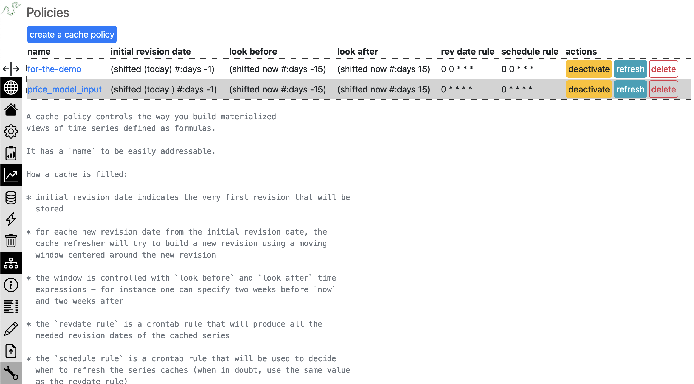

The list at the top shows the existing cache policies. We can create
or edit a policy, leading us to the following policy creation form:

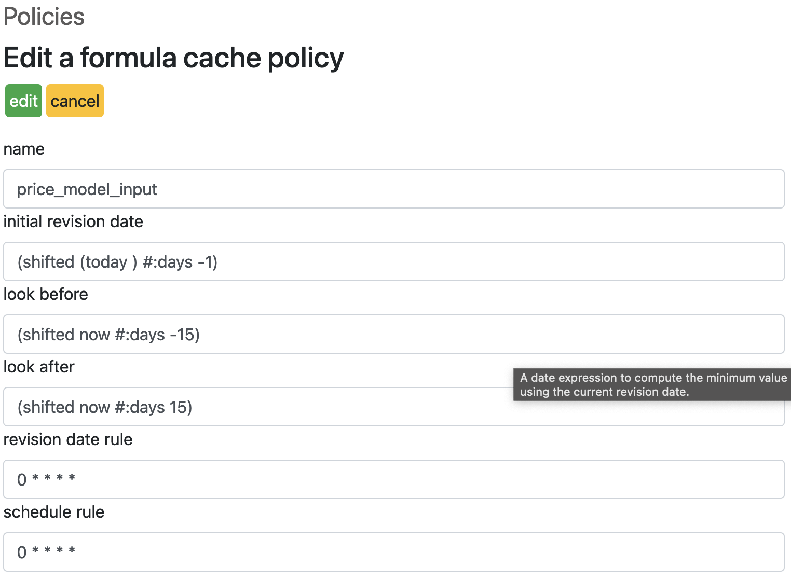

You need to give it a clear name. A cache policy will be associated
with as many formulas as you want, which makes sense provided they
have the same common time and data patterns, as explained in the
previous chapter.

The fields `initial revision date`, `look before` and `look after` all
use the same Lisp-like mini language. Here's the list of available
functions:

* today -> produces a timestamp as of `now`

* shifted <timestamp> -> takes keywords `minutes`, `hours`, `weeks`
  and `months` to shift the input timestamp by the required time delta

* date <datestr> -> turns the date string input into an actual
  timestamp

The `look before` and `look after` will generally use a `now` variable
rather than `today`. When the cache is being updated, this variable
will be valued with the corresponding revision date.

.. code:: lisp

   Examples:

   (today)
   (shifted (today) #:weeks -1)
   (date "2024-1-1")
   (shifted now #:days 15)

The `revision date rule` and `schedule rule` must be described
according to the `cron syntax <https://en.wikipedia.org/wiki/Cron>`_.

When in doubt, you should assign the same value to `schedule rule` and
to `revision date rule`. It sometimes makes sense to schedule the
actual cache update using a different rule than the revision date rule
(to smooth out the strain on server resources for instance).

When the cache policy has been created, it can be of course `edited`
again, `activated` (otherwise nothing happens) or `deleted`.

The last step is managing the series associated with the policy. One
gets there by clicking the policy name in the list.

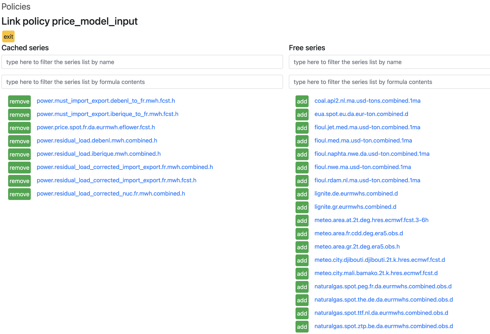

.. _Tasks system: how to organize and schedule tasks:

Tasks system: how to organize and schedule tasks
------------------------------------------------

In this chapter we will survey the basics of the tasks system, how to
write and run tasks, and the best ways to organize them.

The built-in tasks system allows to organize, schedule and run tasks
for (non limitative list):

* data acquisition

* data monitoring

* running models

.. note::

   The builtin tasks manager is not exclusive of any other tasks
   manager you want to use. Dask, Airflow or other such tools are fine
   in and by themselves and can certainly be used along with the
   Refinery if their workflows are more compelling for your specific
   use cases.

Basics: operations, domains, inputs, tasks
..........................................

Let's review the most important concepts.

A `task` is the execution of an `operation`. An `operation` is a
Python function that will run as a task. Here's an example:

.. code:: python

   from rework.api import task

   @task
   def hello(task):
       with.task.capturelogs(std=True):
           print('Hello')

Let's examine what's there:

* the operation is marked by the `task` decorator

* it must be a one parameter function, whose parameter is a `task`
  object.

* the `task` object provides a number of methods, such as
  `capturelogs`

* the `capturelogs` method accepts an `std` parameter, which when True
  turns the output of the print function into logs; `capturelogs`
  records the logs from any logger within its context

Such a task will also run in the "default" `domain`. A domain is
basically a label allowing to group operations. It certainly makes
sense to e.g. have separate domains such as `models` and
`scrapers`. The Web UI permits filtering based on domains.

.. code:: python

   from datetime import timedelta
   from rework.api import task
   import rework.io as rio
   from tshistory.api import timeseries

   from eflower.models import run_co2_forecast

   @task(domain='models',
         inputs=(
             rio.string('zone', required=True),
             rio.moment('fromdate', default='(today)'),
             rio.number('startoffset')
         ),
         timeout=timedelta(hours=2)
   )
   def co2_model(task):
       inputs = task.input
       tsa = timeseries()
       with task.capturelogs(std=True):
           run_co2_forecast(
               tsa,
               zone=inputs['zone'],
               fromdate=inputs['fromdate'],
               start_offset=inputs.get('start_offset', 0)
           )

In this example, we define an operation to run a model, in a dedicated
`models` domain, with typed inputs. Here we see that the `task`
decorator accepts:

* a `domain` parameter (string),

* an `inputs` parameter (tuple of rework.io entities), to specify
  inputs with Web UI support (in the `Launchers` tab)

As can be seen in the code, the inputs come as an attribute of the
`task` object, and is a dictionary.

Registering and running tasks
.............................

Operations defined in a Python module are not magically known from the
system: an explicit single registration step has to be performed.

Let's see the command line way, assuming you have all your operations
definitions in a `tasks.py` module:

.. code:: bash

   $ rework register-operations my_refinery myproject/tasks.py
   registered 2 new operation (0 already known)

The dual operation is available.

.. code:: bash

   $ rework unregister-operation refinery helloworld
   preparing de-registration of:
   delete helloworld default /home/aurelien/tasks.py 10.211.55.4
   really remove those? [y/N]: y
   delete helloworld default /home/aurelien/tasks.py 10.211.55.4

To have a fully working system, the last step is running a monitor for
the `models` domain. A monitor is a program that manages a pool of
workers for a given domain.

.. code:: bash

   $ rework monitor my_refinery --maxruns 2 --maxworkers 4 --minworkers 1 --domain models --vacuum P4D

Let's unpack this:

* `minworkers` specifies the min amount of running workers in the pool,

* `maxworkers` specifies the absolute maximum of workers,

* `maxruns` indicates how many tasks a worker is allowed to run before
  being shut down (and eventually replaced),

* `domain` specifies the domain,

* `vacuum` defines the retention duration of tasks in the `done`
  state, using the `iso 8601
  <https://en.wikipedia.org/wiki/ISO_8601>`_ durations notation.

A good organisation
...................

The notion of `domains` permits to group operations together. There
can be a semantic aspect to the grouping (let's not mix models and
scrapers) and performance aspects, since each domain will be
associated with a monitor, which has its own settings (configuration
of the workers pool and tasks retention duration).

Out of the box, the Refinery uses two domains: `timeseries` and
`scrapers`.

* `timeseries` is used to run the formula cache operations,

* `scrapers` is used to run the scraping operations.

You of course are encouraged to have your own domains. Reasonnable
proposals seen in the field are:

* `models` to run your models,

* `high-frequency` to run operations that really want to run often,
  like e.g. every minute (hence they will clog the tasks list and you
  want to be able to easily filter them out)

Don't forget to run at least one monitor for each domain !

.. note::

   It is possible to run several monitors for one given domain.
   Hypothetical scenario: your computing units are too small to run
   all operations of a given domain in paralell, so you build several
   ones, using a Python environment with the same dependency versions
   on several machines.

Last point: if you have e.g. models but with incompatible requirements
(typically in terms of versions), you can put them in different
domains, managed by monitors living in different Python environments.

Tasks: using the Web UI
.......................

The task manager provides a convenient Web UI to provide the users a
dependable view of the state of the system. The UI provides a number
of tabbed views and a couple of direct views. Let's walk through them.

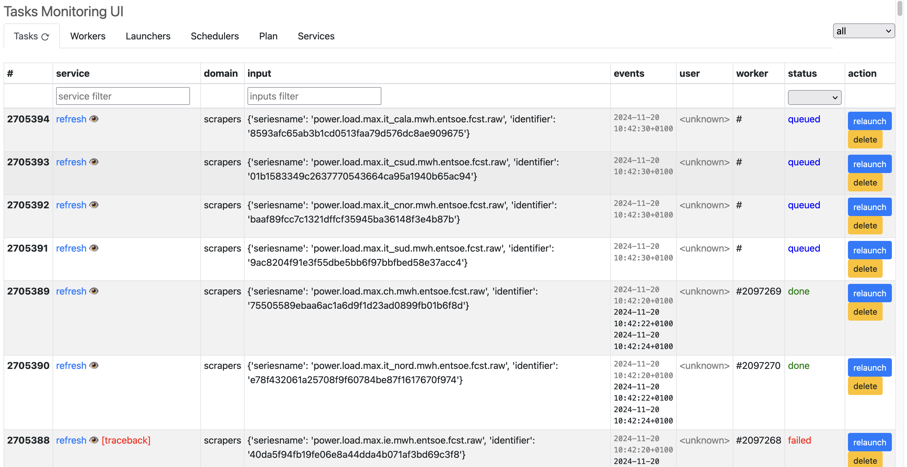

The tasks list is the first thing to be seen when we land on the tasks
manager views. It provides a direct access to the tasks (status,
inputs, domain, logs) and a few actions, in inverse chronological
order (most recent at the top).

By default, the complete list is not loaded. By scrolling downwards,
one gets new lazily loaded items.

The actions available on tasks are:

* relaunch (can be useful when a task has been aborted for some
  reason)

* delete (to unclutter the list)

* abort (available only on running tasks)

.. note::

   For the filters (on the service, inputs and status columns) to work
   appropriately, having everything loaded at once is more
   convenient. The "Tasks" tab provides an action to force load all
   known tasks in the list.

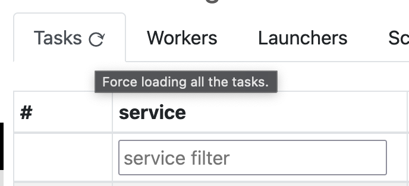

Clicking on the curved arrow symbol will force load all tasks.

By clicking on a task item (blue link on the operation name), one
jumps to the task log (available if it is running or done).

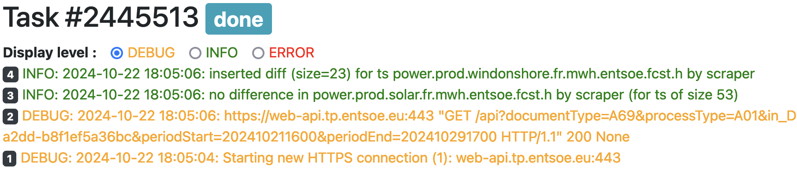

For failed tasks, clicking on the `traceback` link in red opens the
task back trace.

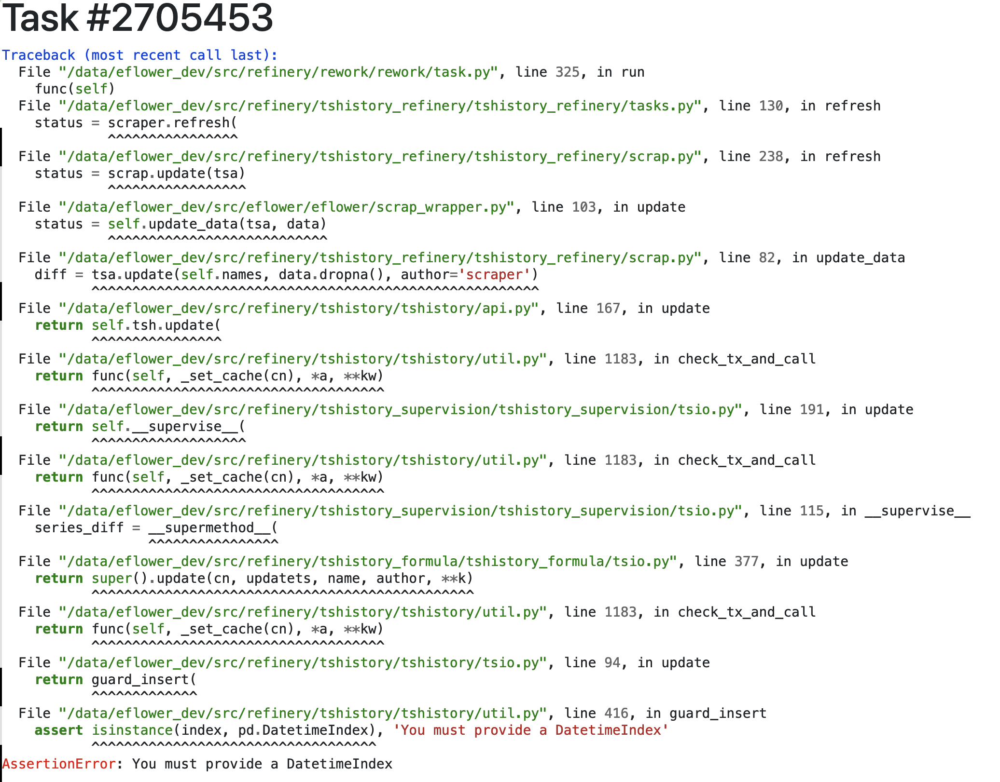

These two last views are important tools to understand what is going
on with your tasks.

The next tab shows the monitors status. As we have seen, monitors
provides workers for a given domain. We can see their state (their
status is updated using a dead-man switch scheme) and their active
workers.

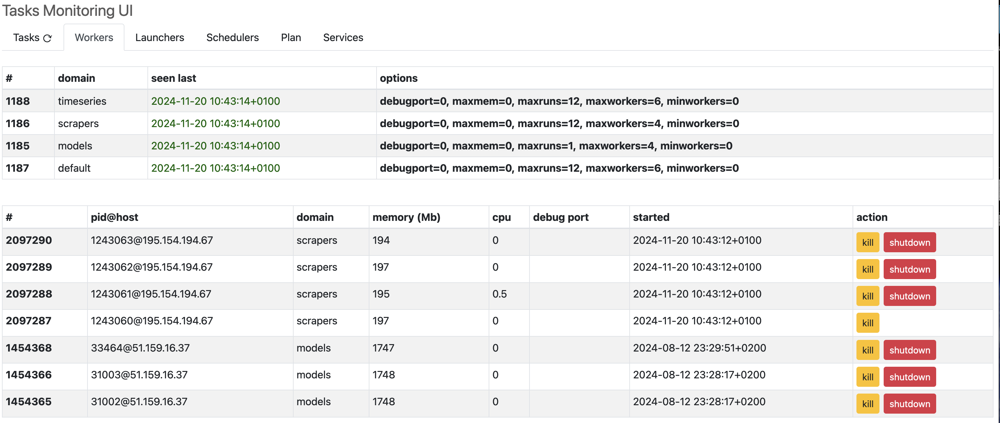

It is possible to ask for a shutdown (the worker will disappear after
finishing its current task), or a kill (the worker is stopped and
removed immediately).

The "Launchers" tab provides a zone to manually launch a task, either
through a "launch now" action (when there are no inputs) or through an
"open form" dialog to allow inputing the relevant operations
parameters before launching.

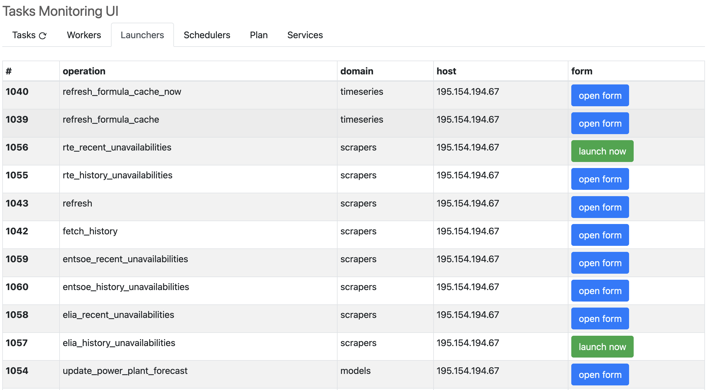

.. note::

   For the tasks to be directly launchable from the Lunchers tab,
   their declaration **must** contain an `inputs` declaration (even
   with an empty tuple if you need none). Only with this formalism can
   the UI know it can present actions, and which ones, to the
   end-user.

The "Schedulers" tab lists all pre-scheduled tasks with their inputs
and schedule rule, also allowing to do an immediate launch if needed.

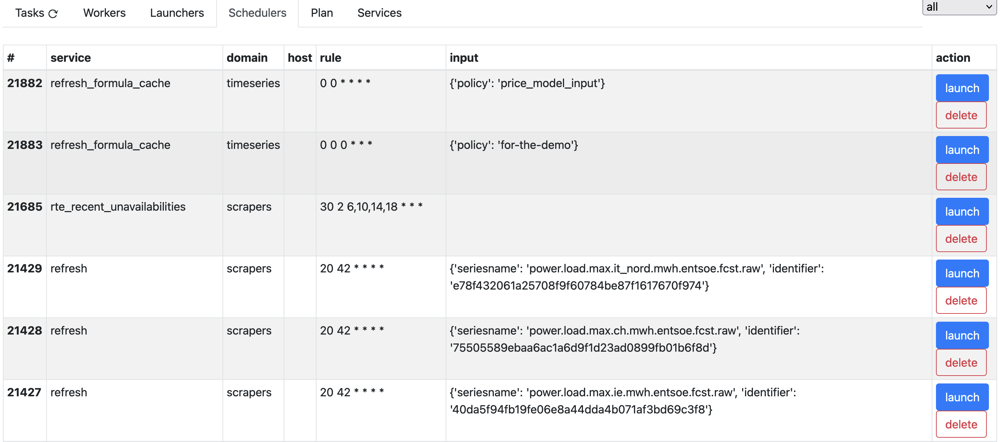

The "Plan" tab shows what tasks (amongst those that are pre-scheduled)
are going to fire, and at which moment, with their inputs, in the next
few hours.

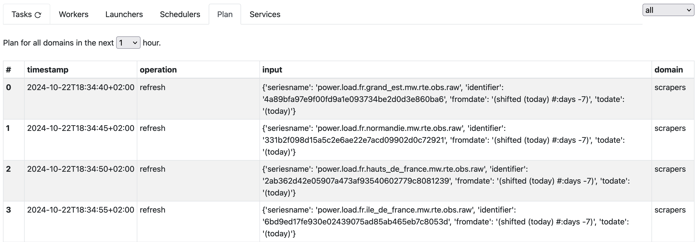

The final "Services" tab lists all the operations, notably with their
host and file system path.

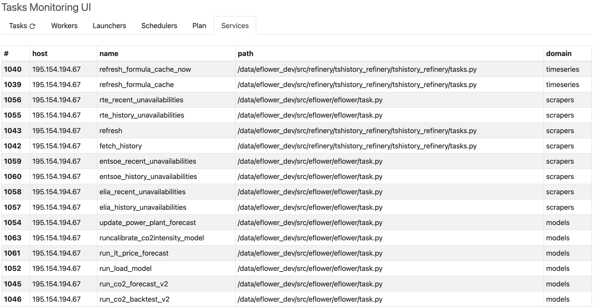

Data architecture at scale: putting the Data Mesh to work
---------------------------------------------------------

For a number of reasons, it may be a good idea to run not just one
instance of the Refinery, but several interconnected in a `data mesh
<https://www.datamesh-architecture.com>`_, and also have some of them
interconnected. Let's see some of the reasons:

* team/topics diversity

* data architecture choice

Making teams work together
..........................

Energy commodity companies sometimes have significant trading desks
with a sizeable amount of analysts, data scientists and IT quant
people working together. These people have different specialties,
scopes and requirements. One useful way to address their specific
needs is to provide a number of Refineries, each dedicated to a
specific group.

Let's imagine an hypothetical department where you have analysts
working on oil, coal, power and gas. The "power" people are interested
into renewables, nuclear, hydro and fossil fuel plants, and "gas"
people are interested in piped and lng gas, also in storages and
terminals. You get the idea. All these people work on production and
demand models, which entails having access to meteorological data
(forecasts).

Putting everyone's data into one big data lake, I mean a big Refinery
instance would quickly turn it into a data swamp, I mean a terrible
mess. What we can propose is that each theme gets its own Refinery
instance. You would have power, gas, oil, meteo, etc. refineries.

But then, the power and gas people (for instance) would need access to
the meteo data, for their forecasting models need meteo forecasts as
inputs.

Also the management would like to have a trans-commodity view of their
position and get something consolidated: we can give them a Refinery
connected to all others (and very little, if any, data of its own).

In this setup, each team can focus on its own needs, and delegate what
they don't master to other teams. The important power team (of several
analysts and data scientists) would rely on the meteo team to provide
them with the relevant solar and wind forecasts. The gas people
modelling the demand would also ask the meteorologists about
temperature forecasts in some places of interest.

So each teams gets its own Refinery, which means a local "data
governance", naming convention, workflows, models, etc. and at the
same time data is easily shared cross-teams.

The Medallion Architecture
..........................

This architecture was invented to address the needs of Data Lake users
and avoid the Data Swamp syndrome which can afflict them. In the
`medallion architecture
<https://medium.com/@junshan0/medallion-architecture-what-why-and-how-ce07421ef06f>`_,
we have layers of data. Each layer corresponds to a data state
("bronze" for raw data, "silver" holds the pre-processed raw data and
"gold" contains completely curated data fit for consumption by
everyone).

This layered approach can be an inspiration for the organization of
Refineries, with:

* a "bronze" Refinery holding data as scraped from the upstream
  providers (in versioned time series form of course), including
  missing data, outliers, changing granularities discontinuities and
  other warts,

* a "silver" Refinery holding mostly formulas based on the "bronze"
  level, where we do proper resampling, basic outliers elimination,
  bogus data overrides, basic aggregations and data assemblies (using
  e.g. the `add` and `priority` formula operators) - this layer knows
  "bronze" which its use as a secondary, read-only source

* a "gold" Refinery used as inputs for the models and also storing
  their outputs, providing data for dashboard and any other decision
  support tools - this layer uses the "silver" curated time series

.. note::

   In a Data Lake, we have a hodge-podge of raw (json, xml) data, non
   relational and relational (with normalized and dernormalized
   relations) data bases, and so on; this complexity cries for the
   application of a doctrine such as the Medallion Architecture. On
   the other hand, Refineries are light-weight and provide structure
   from the start, but still the layering idea has some merit and
   could be put to work for instances with either a lot of time series
   at each levels, or a lot of stake holders at each level, to provide
   more overall clarity and better data governance.
