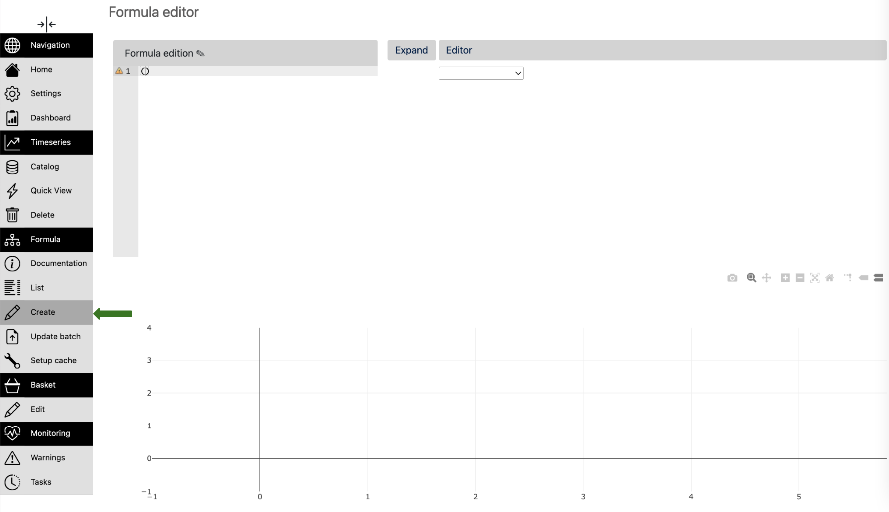
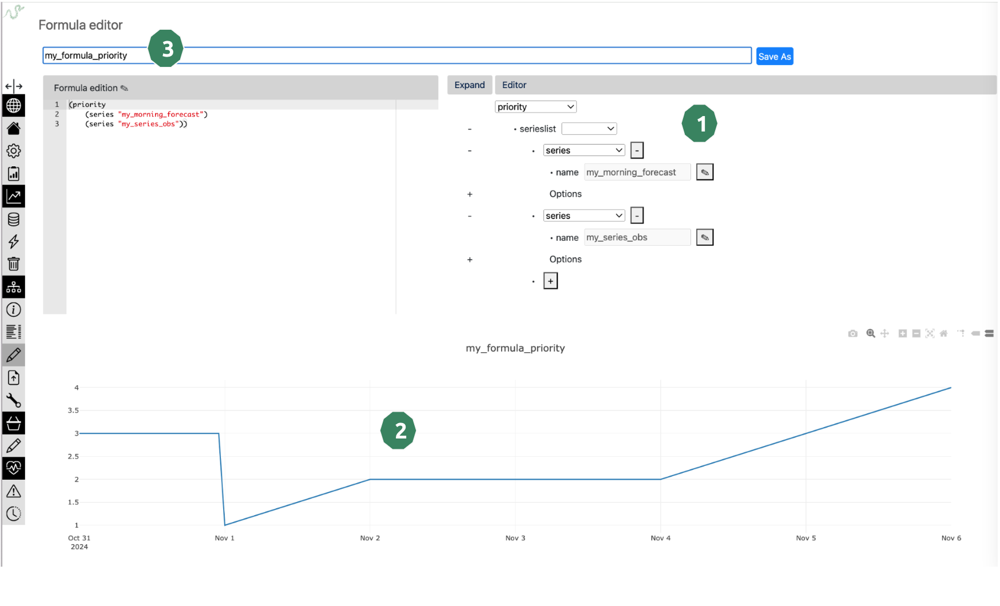
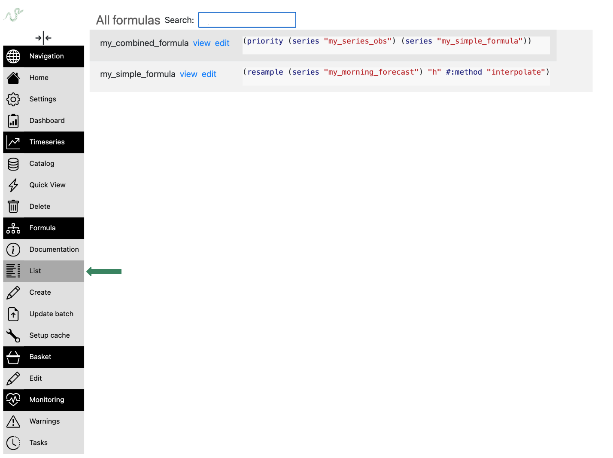

Basics
========

General setup reminder
-----------------------

**Setup your machine**

Let's pip-install the client:

.. code:: bash

   $ pip install tshistory_refinery

And save the config file ``tshistory.cfg`` in the home
directory, containing:

.. code:: ini

   [auth]
   refinery.uri = https://refinery.<myrefinery>.pythonian.fr/api
   refinery.login = <username>
   refinery.password = <password>

**The naming convention : a pillar for your refinery**

First and foremost, users of the refinery need to gather and define
together the naming convention. This is an important aspect of the
**data governance**.

This convention concerns all the series (primary and formulas)
available in the data referential.

Every person of the team needs to know it very well. They will
define new data following this convention and find quickly and
efficiently the data they need.

Here are some tips:

* define the separator of your keywords. Let's choose a dot for our
  example "."

* gather all the types of keywords you could need. Let's assume we
  work with fruits transactions, here is our list:

    * type of aliment
    * type of fruit
    * country of origin
    * country of selling
    * type of transaction (sell/buy)
    * unit (currency/weight)
    * farmer
    * buyer
    * granularity

* choose the most intuitive order of keywords:
  **aliment.fruit.transaction.farmer.buyer.from_country.to_country.unit.granularity**

example :
*fruit.banana.buy.misterfield.superfrenchshop.civ.fr.eur/t.d*

.. note::

   Some of these aspects probably belong to the **metadata** of the
   series. However a good name goes a long way when it comes to making
   a data referential easily usable for everyone. So encoding some

**Initialize timeseries client**

.. code:: python

    from tshistory.api import timeseries
    tsa = timeseries()

How to create / update / read "primary" time series
---------------------------------------------------

**Create a series**

.. code:: python

    import pandas as pd

    ts = pd.Series(
        data=[1, 2, 3],
        index=pd.date_range(start="2024-11-01", freq="D", periods=3)
    )
    seriesname = "fruit.banana.buy.misterfield.superfrenchshop.civ.fr.eur/t.d"

    tsa.update(seriesname, ts, author="fruit@lover")

**Get your series**

.. code:: python

    >>> ts = tsa.get(seriesname)
    >>> ts
    2024-11-01    1.0
    2024-11-02    2.0
    2024-11-03    3.0
    Name: fruit.banana.buy.misterfield.superfrenchshop.civ.fr.eur/t.d, dtype: float64

**Update your series**

Overwrite existing values and add one for the 4th of November:

.. code:: python

    ts = pd.Series(
        data=[5, 6, 7, 10],
        index=pd.date_range(start="2024-11-01", freq="D", periods=4)
    )
    seriesname = "fruit.banana.buy.misterfield.superfrenchshop.civ.fr.eur/t.d"

    tsa.update(seriesname, ts, author="fruit@lover")

Get the new version of the timeseries:

.. code:: python

    >>> ts = tsa.get(seriesname)
    >>> ts
    2024-11-01     5.0
    2024-11-02     6.0
    2024-11-03     7.0
    2024-11-04    10.0
    Freq: D, Name: fruit.banana.buy.misterfield.superfrenchshop.civ.fr.eur/t.d, dtype: float64

.. note::
    The update is as important as get.

    Let's explain its semantics:

    - its input series is used to patch the existing series state
    - existing points with unchanged values will just be dropped
    - new points will be added
    - modified points will be updated
    - points with nan values will erase existing points
    - if there is no difference between the inserted points and the ones in base, no revision is created
    - it returns a series of the points that have been either added, update or erased

How to Exists / Rename / Delete time series
-------------------------------------------

.. code:: python

    >>> tsa.exists(seriesname)
    True
    >>> tsa.rename(seriesname, 'new.name')
    >>> tsa.exists(seriesname)
    False
    >>> tsa.delete('new.name')
    >>> tsa.exists('new.name')
    False

Going further: playing with revisions
-------------------------------------

Now let's assume that we work with a forecast

.. code:: python

    # create a forecast series
    insertion_dates = pd.date_range(
        start=pd.Timestamp('2024-11-01T09:00+00:00'),
        end=pd.Timestamp('2024-11-04T09:00+00:00'),
        freq='D'
    )
    i=0
    for insertion_date in insertion_dates:
        ts = pd.Series(
            [1, 2, 3],
            index = pd.date_range(start=insertion_date.date(), periods=3, freq='D')
        )
        tsa.update(
            'my_morning_forecast',
            ts+i,
            'sensei',
            insertion_date=insertion_date
        )
        i=+1

Let's use the get operator. It will give us the last version of each timestamp.

.. code:: python

    >>> tsa.get("my_morning_forecast")
    2024-11-01    1.0
    2024-11-02    2.0
    2024-11-03    2.0
    2024-11-04    2.0
    2024-11-05    3.0
    2024-11-06    4.0
    Name: my_morning_forecast, dtype: float64

Now, let's investigate our forecast versions.

.. code:: python

    >>> tsa.history("my_morning_forecast")
    {
        Timestamp('2024-11-01 09:00:00+0000', tz='UTC'):
            2024-11-01    1.0
            2024-11-02    2.0
            2024-11-03    3.0
            Name: my_morning_forecast, dtype: float64,
        Timestamp('2024-11-02 09:00:00+0000', tz='UTC'):
            2024-11-01    1.0
            2024-11-02    2.0
            2024-11-03    3.0
            2024-11-04    4.0
            Name: my_morning_forecast, dtype: float64,
        Timestamp('2024-11-03 09:00:00+0000', tz='UTC'):
            2024-11-01    1.0
            2024-11-02    2.0
            2024-11-03    2.0
            2024-11-04    3.0
            2024-11-05    4.0
            Name: my_morning_forecast, dtype: float64,
        Timestamp('2024-11-04 09:00:00+0000', tz='UTC'):
            2024-11-01    1.0
            2024-11-02    2.0
            2024-11-03    2.0
            2024-11-04    2.0
            2024-11-05    3.0
            2024-11-06    4.0
            Name: my_morning_forecast, dtype: float64
    }

If we want to see only the differential :

.. code:: python

    >>> tsa.history("my_morning_forecast", diffmode=True)
    {
        Timestamp('2024-11-01 09:00:00+0000', tz='UTC'):
            2024-11-01    1.0
            2024-11-02    2.0
            2024-11-03    3.0
            Name: my_morning_forecast, dtype: float64,
        Timestamp('2024-11-02 09:00:00+0000', tz='UTC'):
            2024-11-04    4.0
            Name: my_morning_forecast, dtype: float64,
        Timestamp('2024-11-03 09:00:00+0000', tz='UTC'):
            2024-11-03    2.0
            2024-11-04    3.0
            2024-11-05    4.0
            Name: my_morning_forecast, dtype: float64,
        Timestamp('2024-11-04 09:00:00+0000', tz='UTC'):
            2024-11-04    2.0
            2024-11-05    3.0
            2024-11-06    4.0
            Name: my_morning_forecast, dtype: float64
    }

Let's assume we want the forecast of the 3rd of Nov at 12am, after the morning run :

.. code:: python

    >>> tsa.get("my_morning_forecast", revision_date=pd.Timestamp("2024-11-03T12:00:00+00:00"))
    2024-11-01    1.0
    2024-11-02    2.0
    2024-11-03    2.0
    2024-11-04    3.0
    2024-11-05    4.0
    Name: my_morning_forecast, dtype: float64

Adding and fetching metadata
----------------------------

.. code:: python

    tsa.update_metadata(
        "my_morning_forecast",
        {
            'fruit': 'orange',
            'buyer': 'superfrenchshop',
            'seasonal': 0
            'calibration': '2024-10-01'
        }
    )

.. code:: python

    >>> tsa.metadata("my_morning_forecast")
    {
        'buyer': 'superfrenchshop',
        'fruit': 'orange',
        'seasonal': 0,
        'calibration': '2024-10-01'
    }

.. note::
    Metadata is a very important tool to structure the time series referential.
    We insisted on the naming convention in the beginning and indeed good names should be good keys and embed a number of metadata aspects of the series.
    But it is not always enough.

    Metadata, at the Python API level, will be managed with flat Python dictionaries.

Using formulas : create a formula
---------------------------------

A low code formula system has been implemented into the Refinery to transform your raw data into enriched indicators. Time travel capabilities are enabled in all levels of aggregation.

.. code:: python

    tsa.register_formula(
        'my_simple_formula',
        '(resample (series "my_morning_forecast") "h" #:method "interpolate" )'
    )

With this formula, we resample our daily series "my_morning_forecast" to an hourly series.

To get the result of this formula, you can use the get method :

.. code:: python

    >>> tsa.get("my_simple_formula")
    2024-11-01 00:00:00    1.000000
    2024-11-01 01:00:00    1.041667
    2024-11-01 02:00:00    1.083333
    2024-11-01 03:00:00    1.125000
    2024-11-01 04:00:00    1.166667
                            ...
    2024-11-05 20:00:00    3.833333
    2024-11-05 21:00:00    3.875000
    2024-11-05 22:00:00    3.916667
    2024-11-05 23:00:00    3.958333
    2024-11-06 00:00:00    4.000000
    Freq: h, Name: my_simple_formula, Length: 121, dtype: float64

Let's add other series to create more complex formulas:

.. code:: python

    ts = pd.Series(
        data=3,
        index=pd.date_range(start="2024-10-31", freq="h", periods=24)
    )
    seriesname = "my_series_obs"

    tsa.update(seriesname, ts, author="fruit@lover")

Now, let's create a formula with the priority operator.
We can see that a formula can work with primary and/or formulas in a transparent way.

.. code:: python

    tsa.register_formula(
        'my_combined_formula',
        '(priority (series "my_series_obs") (series "my_simple_formula") )'
    )

.. note::
    The priority operator combines its input series as layers. For
    each timestamp in the union of all series time stamps, the value
    comes from the first series that provides a value.

.. code:: python

    >>> tsa.get("my_combined_formula")
    2024-10-31 00:00:00    3.000000
    2024-10-31 01:00:00    3.000000
    2024-10-31 02:00:00    3.000000
    2024-10-31 03:00:00    3.000000
    2024-10-31 04:00:00    3.000000
                            ...
    2024-11-05 20:00:00    3.833333
    2024-11-05 21:00:00    3.875000
    2024-11-05 22:00:00    3.916667
    2024-11-05 23:00:00    3.958333
    2024-11-06 00:00:00    4.000000
    Name: my_combined_formula, Length: 145, dtype: float64

.. note::
    See a more detailed description of the formula system in the following chapter : :ref:`Formulas`

Similarities and differences with primary series
------------------------------------------------

You can easily determine if a series is a primary or a formula by using the `type` method :

.. code:: python

    >>> tsa.type("my_simple_formula")
    'formula'
    >>> tsa.type("my_series_obs")
    'primary'

Another way to identify the type of a series is to look at the internal metadata :

.. code:: python

    >>> tsa.internal_metadata("my_simple_formula")
    {
        'formula': '(resample (series "my_morning_forecast") "h" #:method "interpolate")',
        'tzaware': False,
        'index_type': 'datetime64[ns]',
        'value_type': 'float64',
        'contenthash': 'fd1ca7df8b9a543c4a232ac9125e89ab0cef493a',
        'index_dtype': '<M8[ns]',
        'value_dtype': '<f8'
    }
    >>> tsa.internal_metadata("my_series_obs")
    {
        'tzaware': False,
        'tablename': 'my_series_obs',
        'index_type': 'datetime64[ns]',
        'value_type': 'float64',
        'index_dtype': '<M8[ns]',
        'value_dtype': '<f8',
        'supervision_status': 'unsupervised'
    }

The major difference between primaries and formulas is the impossibility to call the update method on formulas.
Indeed, it is not possible to overwrite a formula value manually.

The other API methods are working on a transparent way :

    * get
    * history
    * metadata
    * rename
    * delete
    * exists
    * source

.. note::
    See a description of these methods in the :ref:`API documentation`.

Using the formula editor
------------------------

The formula editor is accessible from the menu, section `Formulas`, item `Create` :

From this page, you can create a new formula:
    * by using the dropdowns on the right side of the page
    * by writing directly the formula on the left side

The steps are :
    * 1. Formula creation with the tree
    * 2. Plot verification of formula output
    * 3. Enter the name of the resulting formula and click on `Save`

Seeing all the formulas
-----------------------

The list of all formulas is available from the menu, section `Formula`, item `List` :

.. note::
    You can filter formulas with the search bar :
        * on formula name
        * on formula content
