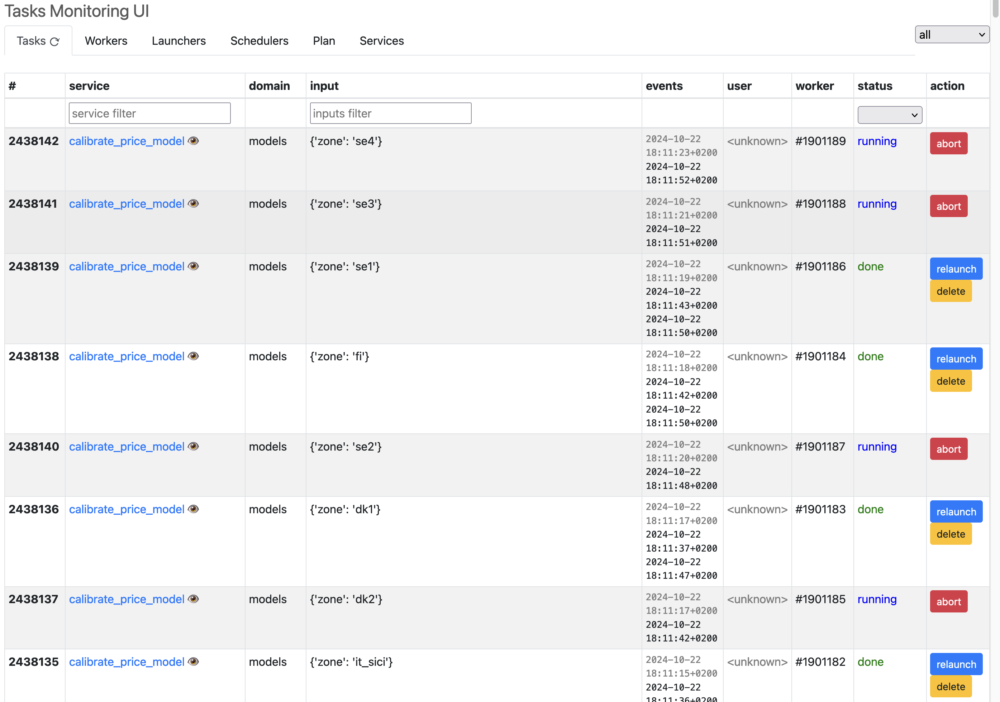
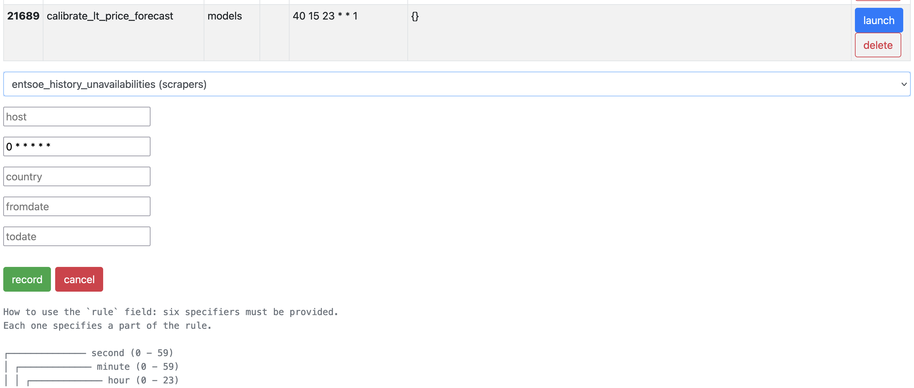

Create a time series information system
=======================================

In the basics chapter, we've seen how to use a number of essential
building blocks.

Building on this knowledge, we want to address a more ambitious goal:
how to write a coherent, well curated time series information system.

We will start from the acquisition of time series data. There are some
challenges there and we will address the most common.

Once we have a complete "primary data" set, made of raw time series,
we will start the process of building the **refined** series that we
can use:

* as input for models

* as input for high-level analysis (e.g. fundamental economic
  analysis)

* as a basis for complex dashboards and decision support systems

At the end of this chapter, you will master all fundamental aspects of
building a complete system.

Pipelines : starting with injecting data
----------------------------------------

Data acquisition is the first step.

Let's start with a simple example, in which we will get forecasts for
renewable production in France. We will use a ready made open source
client to get data from the `ENTSO-E <https://www.entsoe.eu/>`_ data
repository. ENTSO-E itself exposes data for free in the context of the
UE power markets.

.. code-block:: python
   :linenos:

    import pandas as pd
    from entsoe.exceptions import NoMatchingDataError
    from entsoe import EntsoePandasClient
    from tshistory.api import timeseries

    def get_res_generation_forecast_entsoe():
        fromdate = pd.to_datetime('today') - pd.Timedelta(1, 'd')
        todate = pd.to_datetime('today') + pd.Timedelta(7, 'd')
        try:
            df = EntsoePandasClient(api_key='apikey').query_wind_and_solar_forecast(
                'FR',
                start=fromdate.tz_localize('Europe/Paris'),
                end=todate.tz_localize('Europe/Paris'),
            )
        except NoMatchingDataError:
            return

        name_map = {
            'Solar': 'power.prod.solar.fr.mwh.entsoe.fcst.h',
            'Wind Onshore': 'power.prod.windonshore.fr.mwh.entsoe.fcst.h'
        }

        tsa = timeseries()
        for col, name in name_map.items():
            tsa.update(name, df[col], author='entsoe-scraper')

Such a scraping function, put into a Python script, could then be
scheduled to be run at periodic moments of the day to continuously
feed the time series repository; for instance using `cron` on Linux or
`at` on Windows.

This is a bare-bones solution, which unsurprisingly is largely used in
the industry. Some prefer to use sophisticated and refined task
schedulers such as `Apache AirFlow <https://airflow.apache.org/>`_,
for the additional capacities it provides. Later in this document we
will show how to use the Refinery integrated task manager to set up
powerful data acquisition pipelines.

Now, let's back to our scraping function and examine what it does in
detail.

.. code:: python

        fromdate = pd.to_datetime('today') - pd.Timedelta(1, 'd')
        todate = pd.to_datetime('today') + pd.Timedelta(7, 'd')

Here we start by defining the time window for the data to be
fetched. Since it is about forecasts, a window from yesterday to next
week is reasonable.

.. code:: python

        try:
            df = EntsoePandasClient(api_key='apikey').query_wind_and_solar_forecast(
                'FR',
                start=fromdate.tz_localize('Europe/Paris'),
                end=todate.tz_localize('Europe/Paris'),
            )
        except NoMatchingDataError:
            return

Next, we fetch the data using the ENTSO-E client dedicated method. We
provide the `zone` and the time window. On error we exit immediately.

.. code:: python

        name_map = {
            'Solar': 'power.prod.solar.fr.mwh.entsoe.fcst.h',
            'Wind Onshore': 'power.prod.windonshore.fr.mwh.entsoe.fcst.h'
        }

The resulting data frame may have several columns. We *know* (by
reading the documentation) that in our case (zone `FR`) we will have
two columns. We construct a mapping from these column names to the
series names we want to have. It is very important to have a good
naming convention (in our case we indicate: nature of the flux, type
of production, zone, provenance of the data, nature of the data
- forecast is not observed nor a nomination - and finally the
expected granularity).

.. code:: python

        tsa = timeseries()
        for col, name in name_map.items():
            tsa.update(name, df[col], 'entsoe-scraper')

We create the time series refinery api object and then do an update of
the series.

This is one of the simplest thing we can do to acquire data.

.. note::

   This however is a bit ad-hoc and lacks separation of concerns:

   * acquisition and injection happens in the same place

   * the horizon/time window handling is hard-coded

   * there is no handling of metadata, and we won't know easily the
     provenance of the acquired data

   * we hard-coded the zone and time window

   In the chapter on advanced topics we will propose a more structured
   way to organize this and address the issues listed above.

Using the task manager
----------------------

To have this scraping function running, we need a scheduler. We
propose a small tour of the integrated task manager.

Here is how it looks:

The first tab shows the list of tasks that are either:

* queued

* running

* done (or failed or aborted)

Each task shown there is defined by a Python function and an input.

The tasks do not run at arbitrary times: the scheduler tab shows how
tasks will be scheduled.

.. image:: ./schedulers.png

The most important column in this view is `scheduler`: it exposes a
scheduling rule whose syntax obeys the laws of the `cron
<https://en.wikipedia.org/wiki/Cron>`_ tool.

.. note::

   The cron-like notation used for the scheduler actually supports
   rules down to the seconds, hence the 6 fields. The rules for
   seconds are the same as for minutes.

The `plan` tab shows the tasks that will be scheduled in the next 1
hour.

.. image:: ./plan.png

This is all what we need to finely control our scraping
activities. Now let's look at how to land it there !

Writing and using scrapers for primary series
---------------------------------------------

We need to define a task:

.. code:: python

   from rework.api import task

   @task
   def scrap_res_generation_forecast_entsoe(task):
       get_res_generation_forecast_entsoe()

This is the strict minimum. For comfort, we can do a bit more, as in
this version:

.. code:: python

   from rework.api import task

   @task
   def scrap_res_generation_forecast_entsoe(task):
       with task.capturelogs(std=True):
           get_res_generation_forecast_entsoe()
           print('Success !')

The `capturelogs` context manager will make sure the task system will
collect, when the task runs, all the logs. The `std` parameter allows
to also capture everything coming out of the `print` function. Very
handy to trace and follow what is going on.

.. note::

   The `@task` decorator supports various options not shown there. You
   will find a complete description of its capabilities in the chapter
   on the task manager. Notable options are `domain` and `timeout`.

Having written this, we must register the task. We'll do like this
(assuming you have put the code above in a Python module named
`mytasks.py`):

.. code:: bash

   $ rework register-operations refinery mytasks.py

Now, this is ready to run. You can go to the `Launchers` tab and start
your task immediately, or go the `Schedulers` tab and organize its
scheduling rule (there is an action for that at the bottom of the
page).

When the task is appearing in the tasks list, you can click on its
name to get to see the logs. It may look like that:

.. image:: ./tasklog.png

Building formulas on top to get curated series
----------------------------------------------

With the basics of data injection in place, we can now turn to the
construction of the time series we actually want. It is certainly
possible to write *computing functions* and put them into tasks like
we did for data acquisition, but we propose a nicer way to do
it. Indeed, arbitrary Python code is very powerful but it has
downsides:

* it is unsafe (you just can't accept random python code from your
  analysts on the server side of operations), so you need a lengthy
  and costly validation workflow to have it deployed

* it is (by default at least) not type-safe

* it takes quite some time to learn to do it properly

* it is not easily reusable or composable nor shareable (still
  possible but it takes a lot of learning to do it properly)

* seeing the computation may be difficult and auditing it can become
  very complicated quickly

We have a solution to these issues:

* use a very simple safe domain specific expression language to do the
  computations

* call this a "formula language" (like for Excel), suitable for
  non-programmers

* do the computations on the fly (by default: doing materialized
  computations remains possible, especially for performance reasons)

* provide a vast array of composable primitive operators (all of
  pandas can be made available if necessary, plus more)

* define computed time series from this base, that will a) belong to
  the time series referential and b) look like a stored time series
  for all intents and purposes (for the read operations at least)

By limiting the computation power, we actually gain more powers !

In the basics chapter we learnt how to create and use formulas. Let
see how to apply this knowledge to build our time series information
system.

A first step would be *normalization*. Its purpose is to address the
following (non-exhaustive) list of questions :

* do the raw series have the needed granularities ?

* are these granularities actually constant ? If we perform our
  analysis on e.g. hourly time series, can we make sure our
  computation will start from hourly series (without throwing away
  data) ?

* are the raw data using the units we want to work with (e.g. MWh,
  euros) ?

* are the raw series complete or do we need to combine some together
  to get a coherent picture ?

* how do we manage outliers ?

So we can write formulas that provides a first layer of
transformation.

Assuming we scrap the series
`power.price.spot.at.da.eurmwh.entsoe.obs.raw` from ENTSO-E; that
series flipped from hourly to 15-minutely granularity in october 22,
and later reverted back to hourly. We want to prevent this
discontinuity. So let's write a simple formula:

.. code:: lisp

   (resample "power.price.spot.at.da.eurmwh.entsoe.obs.raw" "h")

Using the `register_formula` api call, we create
`power.price.spot.at.da.eurmwh.entsoe.obs.h`:

.. code:: python

 tsa.register_formula(
     'power.price.spot.at.da.eurmwh.entsoe.obs.h',
     '(resample "power.price.spot.at.da.eurmwh.entsoe.obs.raw" "h")'
 )

Meteo temperature time series from `ERA5
<https://www.ecmwf.int/en/forecasts/dataset/ecmwf-reanalysis-v5>`_ are
provided in Kelvin. A conversion to Celsius could be useful:

.. code:: lisp

   (+ -273.15 (series "meteo.area.ch.2t.k.era5.obs.h"))

Completeness: it is not uncommon to have raw series describing the
same fundamental data, while being different in a subtle way. For
instance, one source has a long history but its update frequency on
recent data is spotty; and then you find another source with less
history depth but more stringent update behaviour. Let's combine them
into a well-behaved series:

.. code:: lisp

   (priority
       (series "power.price.spot.dk1.da.eurmwh.entsoe.obs.h")
       (series "power.price.spot.dk1.da.eurmwh.epex.obs.h"))

The `priority` operator is immensely helpful there. It will take the
points of the first series if there are any - barring that, the points
of the second series are selected.

Another situation for `priority`, with 3 series this time: some flux
have observed data, nominated data, and forecasted data. We can
combined these three into a single series:

.. code:: lisp

   (priority
       (series "gas.flow.ne.dunkirk.gassco.msmd.obs")
       (series "gas.flow.ne.dunkirk.gassco.msmd.nom")
       (series "gas.flow.ne.dunkirk.gassco.msmd.fcst")

Outliers: this is a complex topic, which is highly dependent on the
nature of the data. There exists simple situations where bluntly
removing obviously bogus values works. To do that, we can use the
`clip` operator.

.. code:: lisp

   (clip (series "this-series-cannot-be-negative") #:min 0)

Feeding a model with series, getting the output in the system, with the task manager
------------------------------------------------------------------------------------

Overview
........

In this section, we demonstrate how to implement a model in
the timeseries refinery. As an example, we use a simple linear
regression, to emphasize the interaction with the refinery.
A modelisation process will alternate between two main phases:
calibration and forecast.

The calibration process needs input and output data and produces
calibration parameters.

The forecast process needs input data and calibration parameters
and produces output estimation.

The calibration parameters are stored in base, which allows to
decouple the two operations. Moreover, the evolution of these
parameters is valuable information, hence we want to store them
without deleting the previous ones. For this purpose, we use the
dbcache package shipped with `tshistory_refinery`.

This package proposes 3 types of API:
- a cache with an associated lifetime
- a key-value store
- a versioned key-value store

In this case we are using the later (called `vkvstore`).

Initialisation
..............

We initialize in the postgres database a new namespace dedicated to
our models parameters.

In order to to that one has to type the following command:

.. code:: bash

   $ dbcache init-db  <dburi> --namespace calibration

Here are now the necessary python functions.
Necessary imports:

.. code:: python

   import json

   import pandas as pd
   from sklearn.linear_model import LinearRegression
   from sklearn.metrics import r2_score

   from tshistory.api import timeseries
   from dbcache.api import vkvstore

Calibration per se:

.. code:: python

   def calibrate(tsa):
       # input
       x = tsa.get('meteo.area.fr.2t.k.era5.obs.h')
       # output
       y = tsa.get('power.load.fr.mwh.entsoe.obs.h')
       x.name = 'x'
       y.name = 'y'
       common = pd.concat([x, y], axis=1, join='inner')

       predictor = LinearRegression(n_jobs=-1)
       predictor.fit(X=common[['x']], y=common[['y']])
       slope = predictor.coef_[0][0]
       intercept = predictor.intercept_[0]

       # we want to store some indicator of fitness:
       r2 = r2_score(
           common[['y']],
           predictor.predict(common[['x']])
       )
       # we prepare the serialization of the calibration parameters
       # the pickle method should be avoided for archive purpose
       results = {
           'slope': slope,
           'intercept': intercept,
           'r2': r2,
       }

       return results

Save the calibration parameters:

.. code:: python

   def save_coefficients(tsa, results):
       store = vkvstore(tsa.uri, 'calibration')
       # vkvstore use string as keys and bstring as values
       json.dumps(results)
       store.set(
           'linear-calibration-key',
           json.dumps(results).encode('utf-8')
       )

.. note::

   Note the “calibration” string in the vkvstore api which references
   the string used as namespace in the dbcache init-db command.

Now for the forecasting, we need to load the saved parameters:

.. code:: python

   def load_coefficients(tsa):
       store = vkvstore(tsa.uri, 'calibration')
       stored = store.get('linear-calibration-key')
       return json.loads(stored.decode('utf-8'))

And finally read the input data, apply the model on it and store the
results as a timeseries:

.. code:: python

   def forecast(tsa, coefficients):
       x = tsa.get('meteo.area.fr.2t.k.era5.obs.h')
       predicted = x * coefficients['slope'] + coefficients['intercept']
       name = 'power.load.fr.mwh.linear.fcst.h'
       tsa.update(
           name,
           predicted,
           'linear-model'
       )

We can now assemble these operations in two distincts tasks:

.. code:: python

   @task(inputs=(), domain='models')
   def linear_calibration(task):
       with task.capturelogs(std=True):
           tsa = timeseries()
           results = calibrate(tsa)
           save_coefficients(tsa, results)

.. code:: python

   @task(inputs=(), domain='models')
   def linear_forecast(task):
       with task.capturelogs(std=True):
           tsa = timeseries()
           coefficients = load_coefficients(tsa)
           forecast(tsa, coefficients)

This tasks can then be scheduled, accordingly to your
calibration/forecasting rules.
