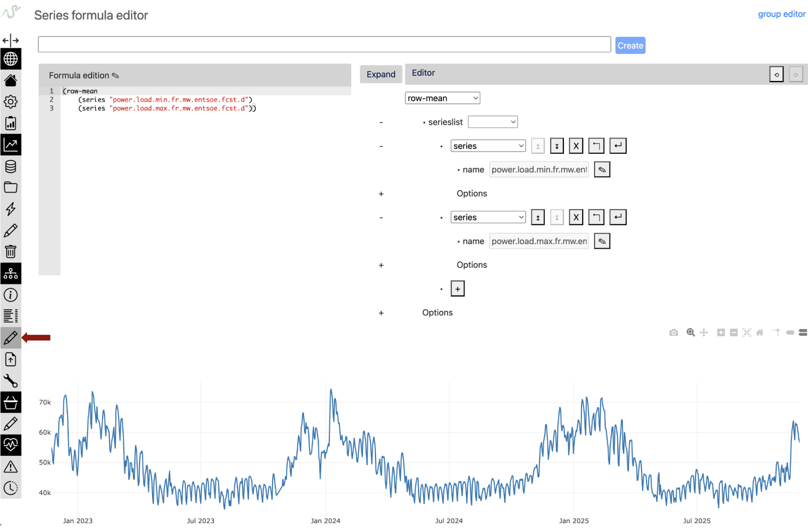

.. _formula_debugging:

Formula Debugging Techniques
============================

While the Refinery formula system catches syntax and type errors
automatically, the most challenging debugging scenarios involve
**semantic issues** - formulas that are syntactically correct but
produce unexpected or wrong results. This guide focuses on systematic
approaches to diagnose and fix these semantic problems.

Table of Contents
-----------------

- `Common Semantic Issues`_
- `Progressive Debugging Strategy`_
- `Data Alignment Problems`_
- `Missing Data Propagation`_
- `Date and Time Semantic Errors`_
- `Formula Dependencies and Recursion`_
- `Understanding the Reactive System`_

Common Semantic Issues
----------------------

**The formula works but the results are wrong.** 
    Here are the most frequent semantic problems:

1. **Data Alignment Issues** - Series with different frequencies or date ranges
2. **Missing Data Propagation** - Holes in data becoming NaNs when series combine
3. **TZ-Aware vs TZ-Naive Incompatibility** - Cannot mix timestamped and date-based series
4. **Time Shifting for Business Periods** - Business days don't align with calendar boundaries
5. **Circular Dependencies** - Formulas depending on each other creating loops
6. **Deep Formula Performance** - Complex formulas becoming slow or hard to debug

Progressive Debugging Strategy
------------------------------

Using the Formula Editor
~~~~~~~~~~~~~~~~~~~~~~~~~~~~~~~

**The formula editor is your primary tool for incremental
formula construction and debugging.** It provides real-time
validation, immediate visual feedback, and powerful debugging
capabilities that make semantic issue detection much easier.

**Key Capabilities:**

**Dual Editor Interface**

The formula editor provides both a text editor with ACE editor
integration for code-based formula editing and a visual tree editor
for graphical formula construction. Changes in either editor
automatically update the other in real-time, allowing you to choose
the interface that best fits your workflow while maintaining perfect
synchronization between both views.

**Real-time Formula Evaluation**

Formulas are automatically evaluated 2 seconds after your last edit,
with results plotted immediately as you type. Syntax and evaluation
errors are highlighted inline using ACE editor annotations, while
loading states provide visual feedback during formula evaluation. This
creates an immediate feedback loop that accelerates the debugging
process.

**Interactive Formula Building**

You can build complex formulas incrementally, with each change
immediately reflected in the plot visualization. The tree editor
provides structured formula building with context-aware editing
assistance, while real-time syntax checking and type validation catch
errors as you work.

**Advanced Editor Features**

The editor includes full undo/redo history tracking for both text and
tree editors, allowing you to experiment freely and revert changes
when needed. You can save and update formulas directly from the
editor, with separate modes for series and group formula
types. Protected formulas can be viewed in read-only mode for
reference without modification risk.

**Incremental Building Workflow in the formula editor:**

.. code-block:: scheme

    ;; Example: Building a complex financial indicator step by step

    ;; Step 1: Start with basic data access (plot immediately visible)
    (series "close_price")

    ;; Step 2: Add simple transformation (see the shift effect)
    (time-shifted (series "close_price") #:days -1)

    ;; Step 3: Calculate returns (observe the scale change)
    (div (sub (series "close_price")
              (time-shifted (series "close_price") #:days -1))
         (time-shifted (series "close_price") #:days -1))

    ;; Step 4: Add smoothing (see noise reduction)
    (rolling (div (sub (series "close_price")
                       (time-shifted (series "close_price") #:days -1))
                  (time-shifted (series "close_price") #:days -1)) 5)

    ;; Step 5: Final indicator with parameters you can adjust live
    (rolling (div (sub (series "close_price")
                       (time-shifted (series "close_price") #:days -1))
                  (time-shifted (series "close_price") #:days -1)) 20)

**Visual Debugging Benefits:**

**Immediate Pattern Recognition**
   - Spot frequency mismatches by observing plot density
   - Detect missing data gaps visually
   - Identify outliers and anomalies in real-time
   - See aggregation effects on data distribution

**Temporal Alignment Verification**
   - Overlay multiple series to check alignment
   - Zoom into specific periods to verify time shifts
   - Visual confirmation of resampling effects
   - Holiday/weekend gap analysis

**Scale and Range Validation**
   - Immediate feedback on value ranges
   - Detect unit conversion issues
   - Spot normalization problems
   - Verify percentage vs ratio calculations

**Common Debugging Patterns in the formula editor:**

.. code-block:: scheme

    ;; Pattern 1: Missing data investigation
    (series "sensor_data")                    ;; See the gaps
    (series "sensor_data" #:fill "ffill")    ;; See fill effect immediately

    ;; Pattern 2: Aggregation verification
    (resample (series "hourly_data") "D")    ;; Check daily aggregation visually
    (resample (series "hourly_data") "D" #:method "sum")  ;; Compare sum vs mean

    ;; Pattern 3: Rolling operation tuning
    (rolling (series "noisy_signal") 5)     ;; Too little smoothing?
    (rolling (series "noisy_signal") 20)    ;; Better smoothing
    (rolling (series "noisy_signal") 50)    ;; Too much smoothing?

Inspect Intermediate Results with python
~~~~~~~~~~~~~~~~~~~~~~~~~~~~~~~~~~~~~~~~

.. code-block:: python

    # Check data properties at each step
    def debug_series(series, name):
        print(f"\n=== {name} ===")
        print(f"Length: {len(series)}")
        print(f"Date range: {series.index.min()} to {series.index.max()}")
        print(f"Frequency: {series.index.freq}")
        print(f"NaN count: {series.isna().sum()}")
        print(f"Value range: {series.min():.4f} to {series.max():.4f}")
        print(f"Sample values:\n{series.head()}")

    # Apply to each step
    returns = tsa.eval_formula('(series "daily_returns")')
    debug_series(returns, "Daily Returns")

    rolling_mean = tsa.eval_formula('(rolling (series "daily_returns") 252 #:method "mean")')
    debug_series(rolling_mean, "252-day Rolling Mean")

Data Alignment Problems
-----------------------

Series with Different Frequencies
~~~~~~~~~~~~~~~~~~~~~~~~~~~~~~~~~~

**Problem**: Combining daily and monthly data without proper alignment.

.. code-block:: python

    # ❌ PROBLEM: This will cause unexpected results
    problematic_formula = '(add (series "daily_sales") (series "monthly_budget"))'

    # The monthly budget gets broadcast/aligned in unpredictable ways
    result = tsa.eval_formula(problematic_formula)
    # Result: Data loss - operation succeeds but produces meaningless results

**Debugging approach:**

.. code-block:: python

    # Inspect the frequency mismatch
    daily_sales = tsa.eval_formula('(series "daily_sales")')
    monthly_budget = tsa.eval_formula('(series "monthly_budget")')

    print(f"Daily sales frequency: {daily_sales.index.freq}")
    print(f"Monthly budget frequency: {monthly_budget.index.freq}")
    print(f"Daily sales length: {len(daily_sales)}")
    print(f"Monthly budget length: {len(monthly_budget)}")

**Solutions:**

.. code-block:: scheme

    ;; Solution: Aggregate daily to monthly (downsampling)
    (add (resample (series "daily_sales") "M" #:method "sum")
          (series "monthly_budget"))
    ;; Downsampling is reliable - aggregation works within known boundaries

    ;; ❌ Solution 3: NEVER DO THIS - Calendar approximation is dangerous!
    (add (series "daily_sales")
          (div (series "monthly_budget") 30))  ;; Calendars are tricky: NEVER APPROXIMATE THEM!
    ;; This fails because months have different lengths (28-31 days)
    ;; February gets wrong allocation, leap years break it, etc.
    ;; ALWAYS use calendar-preserving operations like resample!

Different Date Ranges
~~~~~~~~~~~~~~~~~~~~~~

**Problem**: Series covering different time periods.

.. code-block:: python

    # Debugging date range mismatches
    discontinued = tsa.eval_formula('(series "bloomberg_prices")')  # 2010-2023, stopped feeding
    current = tsa.eval_formula('(series "reuters_prices")')         # 2022-2024, actively updated

    print(f"Discontinued source: {discontinued.index.min()} to {discontinued.index.max()}")
    print(f"Current source: {current.index.min()} to {current.index.max()}")
    print(f"Overlap period: {max(discontinued.index.min(), current.index.min())} to {min(discontinued.index.max(), current.index.max())}")

**Solution:**

.. code-block:: scheme

    ;; Use priority to create seamless time series
    ;; Old source first, then newer source patches/extends it
    (priority (series "bloomberg_prices") (series "reuters_prices"))

Date Range Slicing for Optimization
~~~~~~~~~~~~~~~~~~~~~~~~~~~~~~~~~~~~

Slicing can optimize data retrieval and avoid unnecessary overlap:

.. code-block:: scheme

    ;; Efficient source combination: use Reuters only after Bloomberg ends
    ;; This minimizes database queries by avoiding the 2022-2023 overlap
    (priority
        (series "bloomberg_prices")
        (slice (series "reuters_prices") #:fromdate "2023-01-01"))
    ;; Result: Bloomberg data through 2022, Reuters from 2023 onwards
    ;; Avoids fetching overlapping data from both sources

Missing Data Propagation
-------------------------

Understanding Holes propagation
~~~~~~~~~~~~~~~~~~~~~~~~~~~~~~~

**Problem**: Holes in upstream data are propagated when series are combined.

.. code-block:: python

    # Reality: "Holes" (missing timestamps) are the main issue, not stored NaNs
    sensor_a = tsa.eval_formula('(series "sensor_a")')  # Has data Mon-Fri
    sensor_b = tsa.eval_formula('(series "sensor_b")')  # Has data every day

    # When combined, holes in sensor_a become holes in the result
    combined = tsa.eval_formula('(add (series "sensor_a") (series "sensor_b"))')

    print(f"Sensor A points: {len(sensor_a)}")  # e.g., 250 (weekdays only)
    print(f"Sensor B points: {len(sensor_b)}")  # e.g., 365 (every day)
    print(f"Combined points: {len(combined)}")  # 250 points

    # Note: Some operations can create holes:
    # - div by zero, log of negative values, rolling std with insufficient data
    # But the main challenge is managing holes in upstream series

**Solutions:**

.. code-block:: scheme

    ;; Use fill options strategically
    (add (series "a" #:fill "ffill") (series "b" #:fill "ffill"))

    ;; Use priority for fallback
    (priority (add (series "a") (series "b"))
               (series "backup_calculation"))

    ;; Control aggregation NaN handling
    (row-mean (series "sensor_1") (series "sensor_2") #:skipna #t)

Date and Time Semantic Errors
------------------------------

TZ-Aware vs TZ-Naive: A Fundamental Distinction
~~~~~~~~~~~~~~~~~~~~~~~~~~~~~~~~~~~~~~~~~~~~~~~~

**Context**: The Refinery uses two types of series for different purposes:

- **TZ-aware series**: Timestamped measurements (sensors, market data) - stored in UTC
- **TZ-naive series**: Period-based reference values (regulatory limits, accounting data)

**Problem**: Comparing real-time measurements against daily regulatory thresholds.

.. code-block:: python

    # Real scenario: pollution monitoring vs regulatory limits
    no2_readings = tsa.eval_formula('(series "no2_sensor_readings")')     # TZ-aware (µg/m³ every hour)
    daily_limit = tsa.eval_formula('(series "no2_regulatory_limit")')     # TZ-naive (daily threshold)

    print(f"Sensor readings tz: {no2_readings.index.tz}")  # UTC
    print(f"Regulatory limit tz: {daily_limit.index.tz}")  # None - just dates

    # This fails - cannot compare timestamped data with date-based limits
    try:
        exceedances = tsa.eval_formula(
            '(sub (series "no2_sensor_readings")
                  (series "no2_regulatory_limit"))')
    except TypeError as e:
        print("Cannot mix tz-aware and tz-naive series!")

    # The semantic question: which timezone should define "a day" for the limit?

**Solutions:**

.. code-block:: scheme

    ;; Solution 1: Convert sensor data to naive
    ;; This interprets "a day" according to local calendar
    (sub (naive (series "no2_sensor_readings") "Europe/Paris")
         (series "no2_regulatory_limit"))

    ;; Solution 2: Aggregate hourly data to daily before comparison
    ;; This preserves tz-awareness but creates daily averages
    (sub (resample (series "no2_sensor_readings") "D" #:method "mean")
         (tzaware (series "no2_regulatory_limit") "Europe/Paris"))

    ;; The choice depends on regulatory interpretation:
    ;; - Option 1: Local calendar days
    ;; - Option 2: 24-hour periods in consistent time reference

Time Shifting for Business Period Alignment
~~~~~~~~~~~~~~~~~~~~~~~~~~~~~~~~~~~~~~~~~~~

**Problem**: Business periods often don't align with calendar boundaries.

.. code-block:: scheme

    ;; Example: Gas day runs 06:00 to 06:00
    ;; Hourly gas flow data needs alignment to calendar days

    ;; Raw hourly data
    (series "gas_flow_m3h")
    ;; 2024-01-15 00:00 belongs to gas day 2024-01-14!
    ;; 2024-01-15 06:00 belongs to gas day 2024-01-15

    ;; Shift by -6 hours to align gas day with calendar day
    (time-shifted (series "gas_flow_m3h") #:hours -6)
    ;; Now 2024-01-15 00:00 contains flow from 06:00
    ;; Perfect for daily aggregation by calendar day

Formula Dependencies and Recursion
-----------------------------------

Deep Formula Performance
~~~~~~~~~~~~~~~~~~~~~~~~

**Problem**: Deeply nested formulas can be slow and hard to debug.

.. code-block:: python

    # Check formula depth
    depth = tsa.formula_depth('complex_formula')
    if depth > 20:
        print(f"Warning: depth {depth} may impact performance")

    # For debugging, test at different expansion levels
    for level in [5, 10, 15]:
        partial = tsa.formula('complex_formula', level=level)
        result = tsa.eval_formula(partial)
        print(f"Level {level}: OK" if result is not None else f"Level {level}: Failed")

**Debugging approach:**

Deep formulas are naturally composed of many simpler formulas, each doing one job well.
Use `/tsinfo` interface to navigate the dependency tree and spot where problems occur
(typically bad values or data holes at specific formula levels).

**Performance Optimization**

For formulas with performance issues, the Refinery provides a caching system that can materialize
intermediate results. See :ref:`getting_started/tutorials/advanced:Formulas: when to use a cache/materialized view` for details on setting up cached series.

**Using TSInfo Interface for Formula Analysis**

For a deep formula:

1. Navigate to the series via the catalog search
2. Check the inline plot visualization - toggle "inferred freq" to see data holes as points
3. Review the Statistics panel for data quality metrics
4. Use the Cache tab to see cache status and policies
5. Enable "History mode" to compare revisions and debug temporal issues
6. Use the formula depth selector to examine different expansion levels

Understanding the Reactive System
~~~~~~~~~~~~~~~~~~~~~~~~~~~~~~~~~

The Refinery implements functional reactive programming where formulas are pure functions
computed lazily on demand. Understanding this helps debug unexpected behavior.

**Key Properties:**

**1. Lazy Evaluation**

Updates store data but don't trigger computation:

.. code-block:: python

    # Update primary series
    tsa.update('gas_injection_facility_001', new_data, 'operator')
    # Data is stored, but no formulas compute yet

    # Get a formula that depends on this data
    result = tsa.get('eu_energy_balance_optimized')
    # NOW the entire dependency graph computes
    # (assuming eu_energy_balance_optimized uses gas_injection_facility_001)

**2. Time-Dependent Behavior**

Formulas appear pure but `get()` results can change:

.. code-block:: python

    result1 = tsa.get('deep_formula')
    tsa.update('base_series', new_data, 'operator')
    result2 = tsa.get('deep_formula')
    # result1 != result2 (underlying data changed)
    # But see point 4 - historical data eventually becomes immutable

**3. The "Today" Operator**

The `(today)` operator returns:
- Current date when called without `revision_date`
- The `revision_date` when provided

.. code-block:: scheme

    ;; Formula taking last 30 days
    (rolling (slice (series "data")
                    #:fromdate (shifted (today) #:days -30)) 7)

This creates a moving window that follows either wall-clock time or revision time.

**4. Eventual Purity**

Historical data becomes immutable once "settled":

.. code-block:: python

    # For audit date 2023-12-31, if no more data can be inserted before it:
    year_end = tsa.get('financial_metric', revision_date='2023-12-31')
    # This result is now permanent - perfect for compliance

